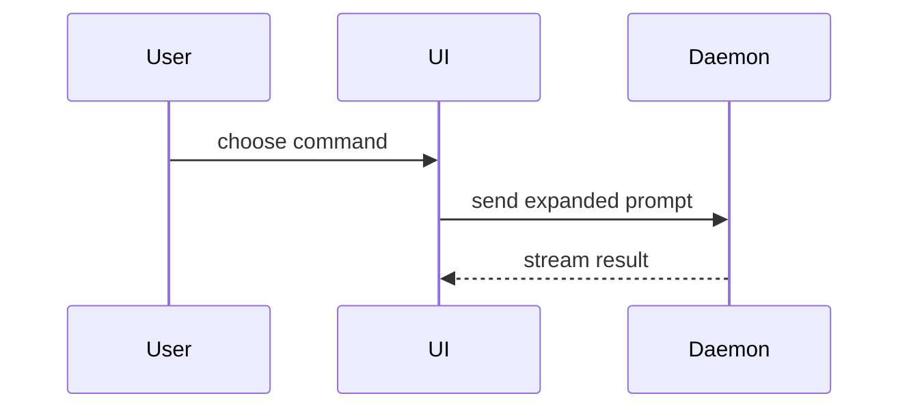

Invoking `/pr` or `$pr` requests an actual GitHub pull request. Complete the workflow below and return its URL. For an explicit body-only request, write the body using the template below and leave Git and GitHub unchanged.

## Workflow

1. Read the repository instructions and inspect the current branch, working tree, commits, and diff to identify the requested changes. Use the user's base branch when specified; otherwise discover the repository's default branch. If on the base branch or a detached HEAD, create a feature branch following the repository's naming convention.
2. Find any open PR for the current head branch. Reuse it when present. If there are no changes to submit and no existing PR, explain that there is nothing to open.
3. Use the available validation evidence for unchanged code and run the repository's required checks for new changes. Commit changes belonging to the task, keeping unrelated local changes out, then push the head branch. A request to create a PR includes these steps.
4. Write a title and body describing the final diff, using the template below and stating validation limits accurately. Use `gh` for GitHub operations and pass multiline bodies through a temporary file with `--body-file`.
5. Create the PR with `gh pr create --base <base> --head <head> --title <title> --body-file <file>`, or update the existing PR's title and body with `gh pr edit`. If the installed CLI's edit command fails on deprecated Projects fields, use `gh api --method PATCH repos/<owner>/<repo>/pulls/<number> --input <json-file>` with the title and body instead. Honor an explicit draft request; otherwise create a normal open PR.
6. Verify with `gh pr view` that the PR exists with the intended base, head, and pushed commit. Attach its URL to the current Codex chat with `attach_artifact` when that tool is available, then return the link. Leave the PR open for review.

Completion means a verified PR URL, not a proposed title or body. If authentication, permissions, or publishing fail, report the concrete blocker and retain the prepared body. Check whether the PR was created before retrying an ambiguous creation failure.

## PR body

Use this template:

```markdown
## Summary

**기능 범위:** <concrete problem and resulting behavior>

**동작 전후**

<diff sketch of the user-visible behavior before and after>

**파일 역할**

<shallow tree of the changed files and their responsibilities>

**처리 흐름**

<Mermaid diagram showing inputs, decisions, state changes, and outputs>

## Evidence

- **Before:** <screenshot/output/failing test run>
  **After:** <screenshot/output/passing test run>

## Merge Danger

**Door:** <one-way or two-way>

<optional: description>

**Blast Radius:** <one-word description>

<optional: potential ramifications of merge>
```

## Sections

Skip all preambles and keep prose brief. Use the user's domain language from `GLOSSARY.md`.

### Summary

Include all three blocks in every PR body: **동작 전후**, **파일 역할**, and **처리 흐름**. Use a behavior diff, a shallow file-responsibility tree, and a Mermaid flow respectively; keep each focused on its own question. For documentation or skill changes, show the authoring or invocation flow rather than inventing an application runtime.

- Show logic or an algorithm as pseudocode:

```text
on(save)
  if content is unchanged
    return cached result
  write new content
  return fresh result
```

- Show runtime control flow as a call tree:

```text
submitForm
  createSession
    persistPrompt
    launchAgent
  navigateToSession
```

- Show UI structure as a component tree, including state and module boundaries that matter:

```text
<SessionPage> (apps/example/src/routes/session.tsx)
  useSessionEvents()
  <SessionToolbar>
    <RunSkillButton> (packages/ui)
```

- Show file responsibility or a broad refactor as a shallow file tree:

```text
src/
├── commands/       # parses user actions
├── sessions/       # owns session state
└── transport/      # sends API requests
```

- Show component interaction, control flow, or data flow with Mermaid:



- Use `diff` when the point is what changes and the surrounding shape already exists. Match the diff shape to the topic.

For a component change:

```diff
 <SessionPage>
   useSessionEvents()
   <SessionToolbar>
+    <RunSkillButton />
   <SessionTimeline>
+    <SkillResultCard />
```

For a file-layout change:

```diff
 src/
 ├── commands/
+│   └── show-me.ts       # expands the slash command
 ├── sessions/
-└── transport.ts
+└── transport/
+    ├── client.ts
+    └── stream.ts
```

For a call-tree or call-stack change:

```diff
 submitForm
   createSession
     persistPrompt
+    expandSkillMention
     launchAgent
-  navigateToSession
+  navigateToSession
+    subscribeToEvents
```

For a state or control-flow change:

```diff
 on(save)
-  write content
+  if content is unchanged
+    return cached result
+  write new content
+  invalidate cache
```

- Show the whole block when most of it is new, when omitted context would hide ownership or order, or when the user needs a copyable target shape:

```ts
function expandSkill(command: string): string {
  const skillName = command.slice(1);
  return `use the ${skillName} skill`;
}
```

#### Guidance

Place each visual next to the short text it supports. Keep only the calls, files, props, states, and boundaries needed to answer the user's current question or the options to resolve the current discussion point.

Keep the three required blocks. Add another visual only when it explains something those blocks cannot show clearly.

### Evidence

Concrete evidence that the change works. Show a before and after.

Screenshots are S-tier - when the environment is set up for it and the change is visual.

Execution-based evidence is A-tier. Test results, console output. Show the exact test that now fails and passes, using pseudocode.

### Merge Danger

Describe whether it's a one-way or two-way door. You can walk back through two-way doors, but not one-way doors. A PR that is cheap to roll back is lower risk. Changes that involve destructive actions or hard-to-reverse decisions are one-way doors.

The blast radius is the potential impact or scope of the changes introduced by this PR. Consider all possibilities. Examples are layout shift, breakages for consumers, mobile responsiveness, etc.
