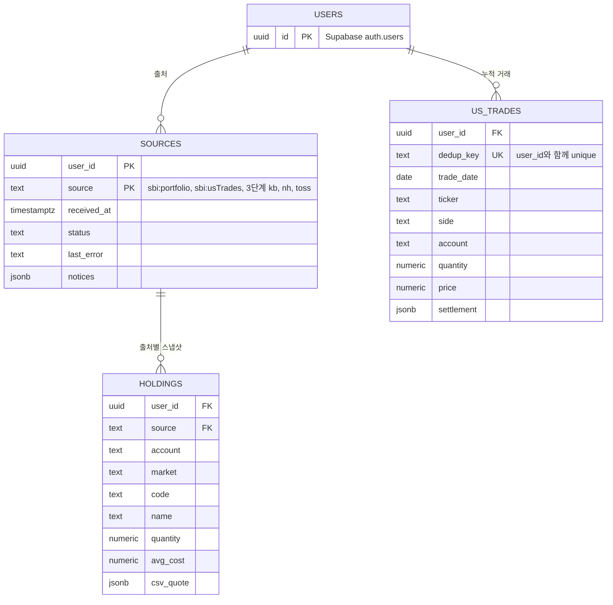

# 아키텍처

1단계 기준이다. 코드가 아직 없어서 디렉토리 구조·데이터 모델·인터페이스는 예정이다. 구현하면서 실제 구조로 고친다. 2단계 이후는 「2단계 이후」 절에 방향만 적는다.

## 스택
- Next.js 16.4 (App Router) + React 19 + TypeScript, npm. Node 22.x·22.18 이상(`engines`), `"type": "module"`.
- UI: shadcn/ui + Tailwind CSS 4. shadcn 컴포넌트는 패키지로 받지 않고, CLI(`npx shadcn add`)로 소스를 `components/ui/`에 복사해 고쳐 쓴다.
  - 색·글꼴·간격 같은 디자인 토큰은 `app/globals.css`의 CSS 변수에 둔다. 화면 코드는 색 값을 직접 쓰지 않고 토큰 클래스(`bg-primary` 등)를 쓴다. 그래야 색을 바꿀 때 `globals.css`만 바꾸면 된다.
  - 디자인 시스템은 루트 [DESIGN.md](../DESIGN.md)에 있고, 이 레포가 원본이다. 구현할 때 토큰 값을 `app/globals.css`의 CSS 변수로 옮기고, 그 뒤 값의 원본은 `globals.css`다.
- 시세: `yahoo-finance2` 4.x. 서버(`/api/quotes`)에서만 부르고 `next.config.ts`의 `serverExternalPackages`에 넣는다.
- 테스트: 순수 로직은 Vitest, 화면 완료 기준은 Playwright 1.64.
- 1단계는 로컬 실행과 Vercel PR 미리보기 배포를 지원한다. 로그인·DB가 없다. 배포 연결과 리뷰 절차는 [DEPLOYMENT.md](DEPLOYMENT.md)를 따른다.
- 2단계부터: Supabase(Postgres · Auth · RLS · Vault).

## 디렉토리 구조 (예정)
```
app/
  page.tsx                  첫 화면. Dashboard를 그린다
  Dashboard.tsx             1단계 셸 (client): localStorage 읽기·쓰기, 파일 받기, /api/quotes 호출, evaluate
  ClearDataDialog.tsx       데이터 지우기 확인: 취소에 포커스, 2년 경고, 지우기 실패 안내
  PortfolioView.tsx         표시 전용: Portfolio → 증권사 국가 › 증권사 › 시장 › 종목 표
  error.tsx                 예상하지 못한 오류: "문제가 생겼습니다 · 새로고침"
  globals.css               Tailwind 진입점 + 디자인 토큰(CSS 변수)
  api/quotes/route.ts       GET /api/quotes?keys=JP:7203,US:AAPL → QuoteProvider
components/ui/              shadcn/ui 컴포넌트. CLI가 복사한 소스라 직접 고쳐 쓴다
lib/                        Next 없이 도는 순수 모듈. 브라우저와 Vitest에서 같이 돈다
  sbi/csv.ts                바이트 → 텍스트(UTF-8, 실패하면 Shift_JIS) → 행·셀, 열 이름으로 찾기, 숫자 읽기
  sbi/detect.ts             내용으로 CSV 종류 판별
  sbi/portfolio.ts          ポートフォリオ → 일본주식 Holding[]
  sbi/us-trades.ts          約定履歴 → UsTrade[], mergeTrades, holdingsFromTrades
  sbi/import.ts             importSbiFiles: 파일들 + SavedV1 → 새 SavedV1 + 파일별 결과
  sbi/guide.ts              받을 CSV 이름과 SBI 메뉴 위치 (화면 안내 문구는 여기에만)
  sbi/fixtures.ts           가짜 CSV 바이트 (PRD 「1단계 완료 기준」 값, Shift_JIS는 hex로)
  quotes/types.ts           QuoteKey · Quote · QuoteProvider
  quotes/yahoo.ts           QuoteKey → Yahoo 심볼(JP는 "7203.T", US는 "." → "-"), 필드 요청
  quotes/fake.ts            고정 현재가·전일 종가 (TRIZON_QUOTES=fake)
  portfolio/types.ts        Broker · Market · Currency · Holding, 증권사 국가·거래통화 표
  portfolio/saved.ts        SavedV1 ↔ 문자열, 모양 전체 검사
  portfolio/browser-store.ts localStorage 읽기·쓰기·백업·지우기, 탭 사이 변경 알림
  portfolio/evaluate.ts     Holding[] + 시세 → Portfolio
  format.ts                 통화별 자릿수, 부호(반올림한 뒤에 부호를 정한다), "N일 전"(now 주입)
  utils.ts                  cn(): 클래스 합치기 (shadcn init이 만든다, cn 패키지에 globals.css의 글자 크기·그림자 이름을 알려 준다)
e2e/acceptance.spec.ts      PRD 「1단계 완료 기준」 1~5
```

## 데이터 모델
출처마다 저장 규칙이 다르다. `ポートフォリオ`는 스냅샷이라 통째로 교체하고, `約定履歴`은 거래 원장이라 쌓는다. 미국주식 보유와 안내는 쌓인 거래에서 매번 다시 계산한다. 그래서 "계산할 수 없는 종목" 안내(PRD U11)도 새로고침 뒤에 다시 나온다.

타입은 zod 스키마에서 뽑는다(열린 질문 「저장 형식 검증」). 아래는 그 모양이다.

```ts
// portfolio/types.ts
type Broker = "SBI" | "KB" | "NH" | "TOSS";      // 증권사 국가: SBI → JP, 나머지 → KR
type Market = "JP" | "US" | "KR";                  // 거래통화: JP → JPY, US → USD, KR → KRW
type Currency = "JPY" | "USD" | "KRW";

type Holding = {                                   // 식별 키: broker + account + market + code
  broker: Broker;
  account: string;      // 증권사 안의 칸. SBI는 預り区分(特定·一般·NISA), 한국 증권사(3단계)는 계좌
  market: Market;
  code: string;         // 거래소 표기 그대로 ("7203", "130A", "AAPL", "BRK.B")
  name: string;
  quantity: number;
  avgCost: number;      // 거래통화 기준 1주당 취득단가
  csvQuote?: { price: number; asOf: string };     // ポートフォリオ의 現在値 (일본주식 대체 시세)
};

// sbi/us-trades.ts
type UsTrade = {
  key: string;          // 중복 제거 키: 거래 값 + 값이 완전히 같은 거래끼리의 출현 순번 (「v1 참고」)
  tradeDate: string;    // YYYY-MM-DD
  ticker: string;
  name: string;
  side: "buy" | "sell"; // 現買·現売만 담는다
  account: string;      // 預り区分
  quantity: number;
  price: number;        // USD 約定単価
  settlement?: { amount: number; currency: "JPY" | "USD" }; // 受渡金額. USD면 1단계 취득원가에, JPY면 3단계 엔화 취득가에 쓴다
};

// portfolio/saved.ts — localStorage 키 "trizon"
type SavedV1 = {
  version: 1;
  sbiPortfolio?: { uploadedAt: string; holdings: Holding[]; notices: string[] }; // 통째 교체
  sbiUsTrades?: { uploadedAt: string; trades: UsTrade[] };                       // 누적
};
```

## 인터페이스
실패 규칙이 PRD 상황별 동작(U번호)과 이어진다.

```ts
// sbi/import.ts — 브라우저에서 돈다
type FileResult = { fileName: string; kind: "portfolio" | "usTrades" | null; error?: string; notices: string[] };
function importSbiFiles(
  files: { name: string; bytes: Uint8Array }[], saved: SavedV1, now: Date,
): { saved: SavedV1; files: FileResult[] };
// - 파일은 전부 반영하거나 하나도 반영하지 않는다. 실패한 종류는 이전 데이터를 그대로 둔다 (U4).
// - 5MB를 넘는 파일은 읽지 않는다 (U4).
// - 머리글을 알아보면 0행도 정상이다 (U45).
// - 約定履歴은 現買·現売만 읽고, 나머지는 notices에 "건너뛴 거래 N건" (U48).

// sbi/us-trades.ts
function mergeTrades(stored: UsTrade[], incoming: UsTrade[]): UsTrade[];   // key로 중복 제거 (U41)
function holdingsFromTrades(trades: UsTrade[]): { holdings: Holding[]; notices: string[] };
// - 날짜순으로 계산하고, 같은 날은 매수를 먼저 계산한다. 취득단가는 이동평균이고(취득원가에 넣는 값은 PRD 「핵심 기능」 2), 수량이 0이 되면 새로 시작한다.
// - 수량이 0인 종목은 뺀다. 매도가 매수보다 많은 종목도 빼고, notices에 "계산할 수 없음: 2년 이전 매수분 필요" (U11).

// portfolio/saved.ts
type LoadResult = { status: "empty" } | { status: "ok"; saved: SavedV1 } | { status: "unreadable" };
function loadSaved(raw: string | null): LoadResult;                        // unreadable이면 그리지 않는다 (U16)
function serializeSaved(saved: SavedV1): string;

// quotes/types.ts
type QuoteKey = `${Market}:${string}`;      // "JP:7203", "JP:130A"(JP는 영숫자 4자리), "US:AAPL"
type Quote = { price: number; previousClose?: number; currency: Currency; marketTime: string };
interface QuoteProvider {
  readonly name: string;
  /** 못 찾은 종목은 결과에서 빠진다. 네트워크·서버 오류는 throw한다. */
  fetchQuotes(keys: QuoteKey[]): Promise<Partial<Record<QuoteKey, Quote>>>;
}
// GET /api/quotes?keys=…
//   200 { quotes } — 빠진 키는 못 찾은 종목 (U8)
//   400 { error }  — 형식이 틀린 키
//   502 { error }  — provider가 throw했거나 10초 안에 답이 없을 때. 화면은 모든 종목을 취득가로 보이고 맨 위에 안내 (U44)

// portfolio/evaluate.ts
type PriceSource = "quote" | "csv" | "cost";                               // cost = 시세 없음 → 취득가로 평가 (U8)
type Row = {
  holding: Holding; price: number; priceSource: PriceSource;
  value: number; pnl: number; dayChange: number; marketTime?: string;     // marketTime: 시장별 시세 시각 (U10)
};
type Totals = Partial<Record<Currency, { value: number; pnl: number; dayChange: number; noQuote: number }>>;
type Portfolio = {
  totals: Totals;                                                          // 1단계는 통화별. 3단계에 표시 통화 합계를 더한다
  countries: { country: "JP" | "KR"; totals: Totals;
    brokers: { broker: Broker; totals: Totals;
      markets: { market: Market; totals: Totals; marketTime?: string; rows: Row[] }[] }[] }[];
};
function evaluate(holdings: Holding[], quotes: Partial<Record<QuoteKey, Quote>>): Portfolio;
// - 시세 통화가 거래통화와 다르거나 marketTime이 7일보다 오래되면 시세 없음으로 다룬다.
// - previousClose가 없거나, csv·cost 행이면 dayChange는 0이다.
```

## 데이터 흐름
```
브라우저: 파일 → importSbiFiles → SavedV1 → localStorage
            ├ ポートフォリオ → 일본주식 Holding[] (통째 교체)
            └ 約定履歴      → mergeTrades → holdingsFromTrades → 미국주식 Holding[]
브라우저: localStorage → loadSaved → Holding[] → GET /api/quotes → 서버: QuoteProvider (yahoo | fake)
브라우저: evaluate(Holding[], 시세) → Portfolio → PortfolioView
```

## 금액·통화
- 거래통화는 시장이 정한다. 일본 = JPY, 미국 = USD. 1단계는 두 통화를 섞지 않고 시장별로 합계를 낸다. 환율은 쓰지 않는다.
- 금액은 `number`로 계산하고, 화면에 보일 때만 통화별 자릿수로 반올림한다. 파싱에 `parseInt`를 쓰지 않는다.
- 미국주식 보유수량·취득단가는 쌓아 둔 `約定履歴`의 現買·現売로 추정한다. SBI에 미국주식 보유 CSV가 없어서다.
- 증권사 국가는 증권사가 정한다. SBI는 일본, KB·NH·토스는 한국(3단계)이다.

## CSV 읽기
- 인코딩: `TextDecoder('utf-8', { fatal: true })`로 먼저 읽고, 실패하면 Shift_JIS(CP932)로 읽는다. `fatal`이 없으면 UTF-8 디코드는 실패하지 않고 글자를 깨뜨린다. BOM은 지운다. 셀은 NFKC로 정규화한다. 모두 브라우저와 Node에서 돈다.
- 분리: 따옴표 안의 쉼표·줄바꿈은 셀 내용으로 두고, `""`는 따옴표 하나로 읽는다. CRLF도 받는다. 셀은 앞뒤 공백을 지운다. 행 끝의 빈 셀은 버리고, 빈 줄은 표의 경계로 남긴다.
- 숫자: 쉼표·공백·`円`·全角 숫자를 받고, `-`·`--`는 빈 값으로 읽는다. `100.0000USD`처럼 통화가 붙은 값은 금액과 통화로 나눈다. 숫자를 읽지 못하면 그 파일을 실패로 처리하고 줄 번호를 보인다. `NaN`은 합계에 들어가지 않는다.
- 종류는 파일 이름이 아니라 내용(`ポートフォリオ一覧`, `約定履歴` 머리글)으로 가린다. 업로드 입력 하나로 여러 파일을 받는다.
- 열은 위치가 아니라 이름으로 찾는다. 정확히 같은 이름을 먼저 찾고, 없으면 괄호 설명이 붙은 이름(`이름(…)`)을 찾는다.

### `ポートフォリオ`
- 셀이 하나인 행은 표 제목이다. 제목에서 預り区分(特定·一般·NISA 등)을 읽어 `Holding.account`에 넣는다.
- 現物 표: 첫 열이 `銘柄(コード)`이고 `取得単価` 열이 있는 머리글. `銘柄(コード)`·`数量`·`取得単価`·`現在値`를 읽는다.
- `7203 トヨタ`는 코드 `7203`과 이름으로 나눈다. `130A` 같은 영문 포함 코드도 받는다.
- 信用 표(`建単価` 열)와 投資信託 표(첫 열 `ファンド名`)는 건너뛰고 "건너뛴 표 N개"로 알린다(PRD U13).
- `…合計`·`総合計` 블록은 보유 종목으로 읽지 않는다.
- 잘린 페이지(`総件数` > `選択範囲`)는 경고한다.

### `約定履歴`
- 머리글: 첫 열이 `国内約定日`이고 `銘柄コード` 열이 있는 행.
- 필수 열: `国内約定日`·`銘柄`·`銘柄コード`·`商品区分`·`取引`·`預り区分`·`約定数量`·`約定単価`. 하나라도 없으면 그 파일을 실패로 처리한다(PRD U4). `受渡金額/決済損益`은 있으면 읽는다(PRD 「핵심 기능」 2의 취득원가).
- `商品区分`이 `米国株式`이고 `取引`이 `現買`·`現売`인 행만 쓴다. 나머지는 건너뛰고 "건너뛴 거래 N건"으로 알린다(PRD U48).
- 1,000건에 닿은 파일은 파일당 한도에 걸려 잘렸을 수 있다. 기간을 나눠 다시 받으라고 경고한다.

## 상태 관리
- 저장한 데이터(`SavedV1`)는 localStorage에 둔다. 시세는 저장하지 않는다. 1단계는 서버에 아무것도 저장하지 않는다.
- `Dashboard`는 `useSyncExternalStore`로 localStorage를 읽는다. 서버 렌더 값은 "불러오는 중"이라, 데이터가 있는데도 빈 화면(U1)이 잠깐 보이는 일이 없다. subscribe는 `storage` 이벤트를 들어서 다른 탭의 변경도 받는다.
- 쓰기 직전에 localStorage를 다시 읽고 그 위에 합친다. 탭 두 개에서 올려도 앞 탭의 거래가 지워지지 않는다.
- `setItem`이 실패하면(사생활 보호 모드, 용량 초과) 화면은 그대로 두고 "저장되지 않았습니다"를 띄운다(U46).
- 못 읽은 데이터(U16)는 발견하면 `trizon:backup` 키로 옮긴 뒤 새로 시작한다. 백업이 성공한 뒤에만 원래 키를 비운다. 이전 백업이 있으면 별도 `trizon:backup:<id>` 키로 보관한다. 백업에 실패하면 원본을 그대로 남기고, 새로 올린 데이터로 덮어쓰지 않는다. 2년 넘은 거래는 SBI에서 다시 받을 수 없어서다. 저장 형식의 version을 올릴 때는 이전 version을 읽는 변환을 함께 넣는다.
- 「데이터 지우기」를 확인하면 보유·거래와 복구용 백업을 지운다. 다른 앱의 localStorage 키는 건드리지 않는다. 실패하면 화면의 보유를 유지하고 확인 창에 오류를 보인다.
- 새 시세 요청을 보내면 이전 요청은 `AbortController`로 끊는다. 늦게 온 옛 응답이 새 응답을 덮지 않는다.
- dev 주소는 `localhost:3000`으로 고정한다. localStorage는 origin마다 따로라서, `127.0.0.1`이나 다른 포트로 열면 데이터가 사라진 것처럼 보인다. Playwright `baseURL`도 같은 주소를 쓴다.
- localStorage 한도(대략 5MB)는 거래 수천 건이 들어가도 충분하다.

## 오류 처리
1. 실패는 조용히 0이 되거나 합계에서 빠지지 않는다. 반드시 화면에 보인다. 어떤 실패가 어떻게 보이는지는 PRD 「상황별 동작」에 있다.
2. 파일은 전부 반영하거나 하나도 반영하지 않는다. 실패하면 이전 데이터를 그대로 둔다.
3. 예상하지 못한 오류는 `app/error.tsx`가 받는다.

하지 않는 것: 재시도·백오프(사용자가 「시세 새로고침」을 누른다), 사용자용 백업·내보내기, 보정 UI, 분할 자동 보정(PRD 열린 질문 「주식 분할·티커 변경」의 조건이 맞을 때까지).

## 보안
- 1단계
  - Vercel 배포는 Vercel Authentication의 All Deployments로 접근을 제한한다. 앱 로그인과 별개이며, 메인 배포와 첫 배포도 보호한다.
  - CSV에서 온 문자열(종목명 등)은 React 텍스트로만 그린다.
  - CSV 원문과 보유 내역은 콘솔·서버 로그에 남기지 않는다. 리포가 공개라 로그와 스크린샷이 그대로 퍼질 수 있다.
- 2단계 (Supabase)
  - 모든 테이블에 RLS를 처음부터 켠다. 읽기(`using`)와 쓰기(`with check`) 둘 다 `user_id = auth.uid()`로 건다. 쓰기 쪽을 빠뜨리면 남의 `user_id`로 행을 넣을 수 있다.
  - `NEXT_PUBLIC_`에는 Supabase URL과 anon(publishable) 키만 둔다. 모든 읽기·쓰기를 RLS 아래 사용자 권한으로 하므로 service role 키는 쓰지 않는다.
  - anon 키는 공개되므로 누구든 가입할 수 있다. 로그인 방식은 Google만 켜고, 내 계정을 만든 뒤 8단계 전까지 새 가입을 막는다.
- 3단계: 증권사 키와 토스 OAuth 토큰은 Supabase Vault에 두고 브라우저로 보내지 않는다. 8단계에 공개하면 남의 키를 맡게 되므로, 그 전에 PRD 가설 H8을 확인한다.
- 8단계: `/api/quotes`는 로그인한 사용자만 부른다(열린 질문 「8단계 시세 출처」).

하지 않는 것: localStorage 암호화(1단계는 로컬 1인이고 「데이터 지우기」가 있다), CSP, 1단계 호출 제한.

## 2단계 이후
구현하지 않고 방향만 적는다. 보안 규칙은 「보안」에 있다.

### 2단계: Supabase
- 클라우드 무료 프로젝트를 쓰고, 앱은 로컬 실행을 기본으로 한다. PR 미리보기의 인증·데이터 환경 설정은 해당 구현에서 별도로 다룬다. 무료 프로젝트는 7일 동안 활동이 적으면 일시 정지된다(PRD 열린 질문 「Supabase 일시 정지」).
- 마이그레이션은 Supabase CLI(`supabase/migrations/*.sql`)로 관리한다. DB 타입은 `supabase gen types`로 만든다.
- 로그인은 Supabase Auth의 Google provider로 한다. 세션 갱신은 Next 16의 `proxy.ts`(예전 `middleware.ts`)에서 한다.
- 1단계 `SavedV1`은 첫 로그인 때 한 번 읽어 옮긴다(PRD F2). 서버도 같은 zod 스키마로 검사한다.
- 보유를 받는 방법은 증권사마다 다르다(SBI는 CSV, 한국 3사는 API). 어느 쪽이든 같은 `Holding`을 채우고, 출처별 스냅샷은 통째로 교체한다.

엔터티 초안 (2단계):



### 3단계
- 금액 규칙은 v1 결정 003을 따른다.
  - 종목은 계좌통화(SBI 엔, 한국 원)로 평가한다. 미국주식은 계좌통화 매입금액으로 평가해 환차손익을 넣는다.
  - 계좌통화 매입금액을 모르면 현재 환율로 환산하고, 환차손익이 빠졌다고 표시한다.
  - 표시 통화 합계는 계좌통화 금액을 현재 환율로 모은다. 그래서 표시 통화를 바꿔도 총수익률이 같다. 이 성질은 테스트로 고정한다.
  - 1단계 `evaluate`는 거래통화 기준이므로 3단계에서 바뀐다.
- 테이블을 더한다: `broker_connections`(증권사 연결, 키는 Vault), `profiles`(표시 통화).
- 환율 provider를 QuoteProvider 옆에 둔다(`asOf`와 폴백 포함).
- 한국 종목의 Yahoo 접미사(`.KS`·`.KQ`)는 증권사 API가 주는 시장 구분으로 정한다(spike에서 확인).
- 데이터 흐름이 서버 중심으로 바뀐다. 동기화 결과도 `sources`·`holdings`에 같은 규칙으로 쓴다(U27: 실패하면 마지막 성공을 유지).

## 테스트
- `lib/`는 Next 없이 Vitest로 돈다. 외부 시세는 QuoteProvider 뒤에 두고, 테스트는 가짜 provider를 쓴다. 테스트는 네트워크를 쓰지 않는다.
- 실제 시세는 `npm test`에 넣지 않고 `npm run quote:smoke`로 따로 확인한다.
- Shift_JIS fixture는 hex 바이트로 둔다. `TextEncoder`는 UTF-8만 만든다.
- 가짜 종목은 형식이 맞는 가짜 코드를 쓴다. PRD 표의 JP-A 등과의 대응은 `fixtures.ts`에 둔다.
- "N일 전"은 `now`를 주입해 테스트한다. `format`은 반올림한 뒤에 부호를 정한다(`-0.00` 방지).

| 확인할 것 | 확인하는 테스트 |
|---|---|
| 완료 기준 1. 첫 화면 = 대시보드, 빈 상태 | e2e |
| 완료 기준 2. 4종목, 수량·취득단가, 시장 구분, 증권사 아래 배치 | `sbi/*` 단위 + e2e |
| 완료 기준 3. 평가액·평가손익·전일 대비, +/−, 소수 보존 | `evaluate` · `format` 단위 + e2e |
| 완료 기준 4. 시장별 합계(전일 대비 포함) | `evaluate` 단위 + e2e |
| 완료 기준 5. 새로고침 뒤 유지, 데이터 지우기 | `saved` · `browser-store` 단위 + e2e |
| U4 파일별 실패: 인코딩(`fatal`), 숫자 규칙, 전부 아니면 반영 안 함, 5MB | `sbi/csv` · `sbi/import` 단위 |
| U5 교체·누적, U41 중복 제거(같은 값끼리 출현 순번), U48 現買·現売 밖 건너뜀 | `sbi/import` · `sbi/us-trades` 단위 |
| U11 매도 > 매수는 빼고 안내, 같은 날 매수 먼저, 수량 0 뒤 취득단가 새로 시작 | `sbi/us-trades` 단위 |
| 미국 취득원가: USD `受渡金額`, 엔 결제·`受渡金額` 없음 → 수량 × `約定単価` | `sbi/us-trades` 단위 |
| CSV 분리(따옴표·`""`·CRLF), 통화가 붙은 값, `ポートフォリオ` 표 판별·合計 제외, `約定履歴` 필수 열·`商品区分` | `sbi/csv` · `sbi/portfolio` · `sbi/us-trades` 단위 |
| U12 預り区分별 행, U13 건너뛴 표, U45 0행 | `sbi/portfolio` 단위 |
| U8 시세 없음·통화 불일치·7일 넘은 시세 → 취득가, 전일 종가 없음 → 전일 대비 0 | `evaluate` 단위 |
| U16 못 읽는 저장 데이터 → `trizon:backup` | `saved` · `browser-store` 단위 + e2e |
| `/api/quotes` 200·400·502 | route 단위 (fake provider) |

## v1 참고
- v1 코드는 태그 `v1-final`에 있다(`git show v1-final:<경로>`). 볼 곳:
  - `lib/sbi/csv.ts`, `lib/sbi/parse.ts`, `lib/sbi/us-trades.ts`, `lib/sbi/guide.ts`(CSV 받는 곳 안내)
  - `lib/sbi/AGENTS.md`: 約定履歴 중복 제거 규칙. 날짜·ticker·매수/매도·수량·단가·預り区分·결제일/금액이 같은 거래끼리 출현 순번을 붙여 가린다. 그래서 같은 파일을 다시 올려도, 기간이 겹친 파일을 올려도 한 번만 센다. 한 파일 안의 같은 값 거래 여러 건은 그대로 남는다.
  - `lib/quotes/yahoo.ts`, `next.config.ts`(`serverExternalPackages`), `lib/portfolio/fx.ts`(3단계 계좌통화 환산)
- 결정 기록: `docs/decisions/001-local-only.md`(로컬 전용), `002-manual-input.md`(한국 3사 API 조사, 2026-09), `003-broker-screen-returns.md`(계좌통화 기준 수익률).
- 1단계에 필요한 부분만 새로 쓴다. 信用·投信·実現損益·配当 파서, 보정 UI, 로컬 파일 저장은 가져오지 않는다.

## 1단계 구현 순서
1. Next.js 스캐폴드: `create-next-app`, TS, App Router, ESLint, `src/` 없음, Tailwind 포함. 이어서 `shadcn init`으로 `components.json`·`lib/utils.ts`·`app/globals.css`를 만들고, `DESIGN.md`의 토큰 값을 `globals.css`의 CSS 변수로 옮긴다. 옮긴 뒤 `DESIGN.md` 토큰 표의 값 열은 CSS 변수 이름으로 바꾼다. 「스택」의 Node·`"type": "module"`·`serverExternalPackages`, Vitest 설정과 dev 주소 고정을 함께 한다. `.gitignore`는 지금 항목을 유지하고, Next 기본 항목과 `*.csv`를 더한다.
2. 나머지는 화면 동작 단위로 자른 이슈로 진행한다. 무엇을 먼저 할지는 각 이슈의 선행 관계(GitHub 이슈 의존성)를 따른다.
   - [#17](https://github.com/padahkim/trizon/issues/17) 빈 대시보드 첫 화면
   - [#18](https://github.com/padahkim/trizon/issues/18) `ポートフォリオ` 올리기 → 일본주식 표
   - [#19](https://github.com/padahkim/trizon/issues/19) 시세 받기 → 현재가·전일 대비
   - [#20](https://github.com/padahkim/trizon/issues/20) `約定履歴` 올리기 → 미국주식 표
   - [#21](https://github.com/padahkim/trizon/issues/21) 읽지 못한 파일과 건너뛴 표 알리기
   - [#22](https://github.com/padahkim/trizon/issues/22) 데이터 지우기와 저장 실패
   - [#23](https://github.com/padahkim/trizon/issues/23) 1단계 완료 기준 전체 e2e와 문서를 실제 구조로
   - [#24](https://github.com/padahkim/trizon/issues/24) 실제 SBI CSV로 숫자 대조

## 열린 질문
기본값으로 진행한다. 정해지면 해당 절로 옮기고 여기서 지운다.

1. 시세 API: 기본: `yahoo-finance2`. 무료이고 키가 없지만 비공식이라 깨질 수 있다.
2. 저장 형식 검증: 기본: zod 스키마를 타입의 단일 출처로 쓴다(v1과 같다). 2단계 서버 검사도 같은 스키마를 쓴다.
3. DB 접근(2단계): 기본: supabase-js와 생성된 타입을 쓰고, ORM은 쓰지 않는다.
4. 한 번에 올린 `ポートフォリオ` 여러 개: 기본: 받지 않고 하나만 올리라고 안내한다.
5. 8단계 시세 출처: 기본: Yahoo를 서버 캐시 뒤에 두고, 로그인한 사용자만 부르게 한다. 다른 사용자에게 열기 전에 약관과 호출 한도를 확인한다. 한 서버 IP에서 여러 사용자의 호출이 몰린다.
