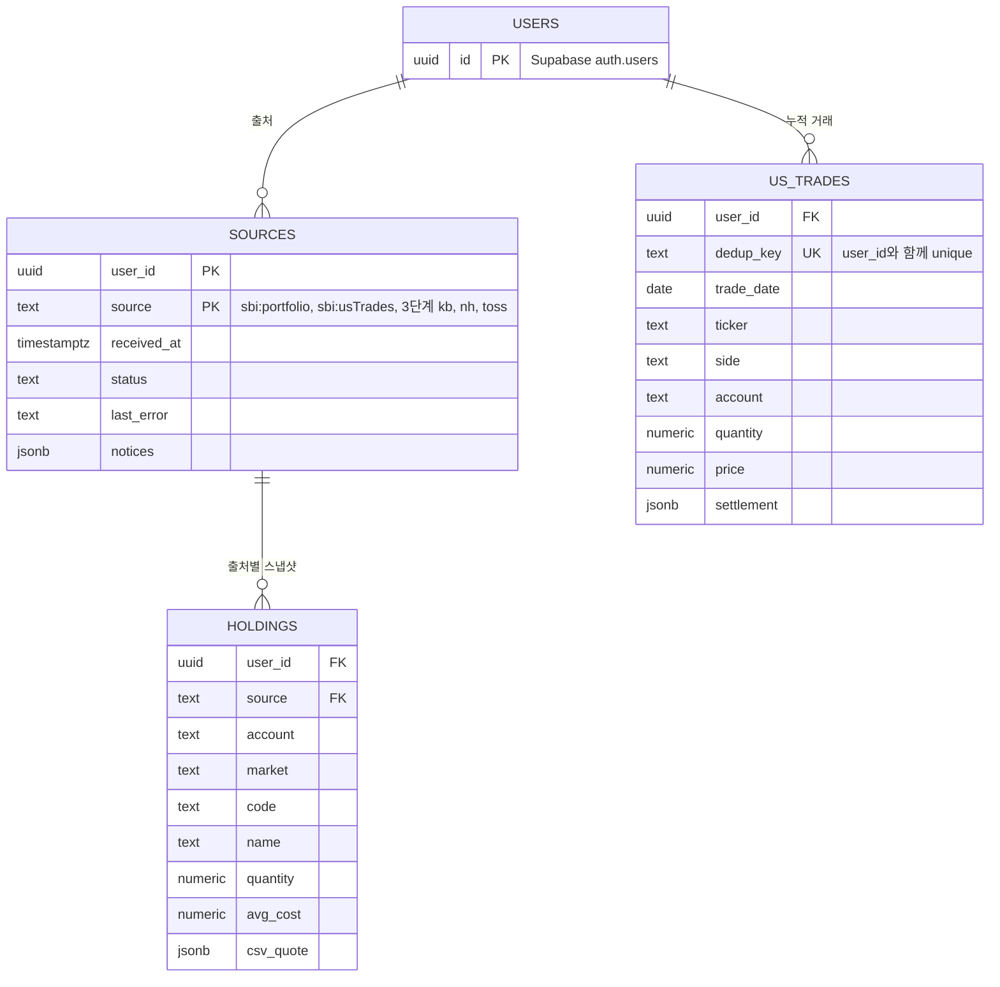

# 아키텍처

1단계의 현재 구현을 설명한다. 타입과 함수 정의의 원본은 아래에서 가리키는 코드 파일이다. 2단계 이후는 「2단계 이후」 절에 방향만 적는다.

## 스택
- Next.js 16.4 (App Router) + React 19 + TypeScript, npm. Node 22.x·22.18 이상(`engines`), `"type": "module"`.
- UI: shadcn/ui + Tailwind CSS 4. shadcn 컴포넌트는 패키지로 받지 않고, CLI(`npx shadcn add`)로 소스를 `components/ui/`에 복사해 고쳐 쓴다.
  - 색·글꼴·간격 같은 디자인 토큰은 `app/globals.css`의 CSS 변수에 둔다. 화면 코드는 색 값을 직접 쓰지 않고 토큰 클래스(`bg-primary` 등)를 쓴다. 그래야 색을 바꿀 때 `globals.css`만 바꾸면 된다.
  - 디자인 시스템은 루트 [DESIGN.md](../DESIGN.md)에 있고, 이 레포가 원본이다. 구현할 때 토큰 값을 `app/globals.css`의 CSS 변수로 옮기고, 그 뒤 값의 원본은 `globals.css`다.
- 시세: `yahoo-finance2` 4.x. 서버(`/api/quotes`)에서만 부르고 `next.config.ts`의 `serverExternalPackages`에 넣는다.
- 테스트: 순수 로직은 Vitest, 화면 완료 기준은 Playwright 1.64.
- 1단계는 로컬 실행과 Vercel PR 미리보기 배포를 지원한다. 로그인·DB가 없다. 배포 연결과 리뷰 절차는 [DEPLOYMENT.md](DEPLOYMENT.md)를 따른다.
- 2단계부터: Supabase(Postgres · Auth · RLS · Vault).

## 디렉토리 구조
```text
app/
  layout.tsx                문서 언어·메타데이터, globals.css 진입점
  page.tsx                  첫 화면. Dashboard를 그린다
  Dashboard.tsx             1단계 셸 (client): 저장·업로드·평가·요약과 증권사 틀
  AssetSummary.tsx          일본 엔 소계·미국주식 통화 전환·엔화 총자산·적용 환율 안내
  SbiTotal.tsx              SBI 제목 옆 엔화 총액·마우스/키보드 상세 내역 툴팁
  SbiCard.tsx               SBI 카드 전체 파일 드롭·중첩 진입 추적·강조 안내·읽는 중 차단
  Uploader.tsx              여러 파일 선택, SBI CSV 다운로드 안내
  useQuotes.ts              /api/quotes 호출·새로고침·취소·실패 상태
  useExchangeRate.ts        미국 보유가 있을 때 USD/JPY 조회·갱신·취소·실패 처리
  ClearDataDialog.tsx       데이터 지우기 확인: 취소에 포커스, 2년 경고, 지우기 실패 안내
  PortfolioView.tsx         시장별 종목 표·합계·계산 안내, Delta(금액·퍼센트)
  UsBaselineEditor.tsx      미국주식 기준 보유정보 입력·목록 관리·삭제 확인
  error.tsx                 예상하지 못한 오류: "문제가 생겼습니다 · 새로고침"
  globals.css               Tailwind 진입점 + 디자인 토큰(CSS 변수)
  api/quotes/route.ts       GET /api/quotes → 환경에 따라 Yahoo 또는 fake provider 선택
  api/exchange-rate/route.ts GET /api/exchange-rate → 공개 USD/JPY 또는 가짜 환율
components/ui/              shadcn/ui의 alert·alert-dialog·badge·button·card·input·label·table·tooltip 소스
lib/                        Next 없이 도는 모듈. 단위 테스트는 대상 옆의 *.test.ts
  sbi/csv.ts                바이트 → 텍스트(UTF-8, 실패하면 Shift_JIS) → 행·셀, 열 이름·숫자 읽기
  sbi/detect.ts             내용으로 CSV 종류 판별
  sbi/portfolio.ts          ポートフォリオ → 일본주식·투자신탁 Holding[]
  sbi/us-trades.ts          約定履歴·기준 보유정보 스키마, 거래 누적·보유 계산
  sbi/import.ts             importSbiFiles: 파일들 + SavedV1 → 새 SavedV1 + 파일별 결과
  sbi/guide.ts              받을 CSV 이름과 SBI 메뉴 위치 (화면 안내 문구는 여기에만)
  sbi/fixtures.ts           완료 기준 e2e의 가짜 CSV 바이트 (Shift_JIS는 hex로)
  quotes/types.ts           QuoteKey · Quote · Quotes · QuoteProvider, 시세 키·응답 검증 스키마
  quotes/handler.ts         요청 키 검사, 중복 제거, provider 호출·10초 제한, HTTP 응답
  quotes/yahoo.ts           QuoteKey → Yahoo 심볼(JP는 "7203.T", US는 "." → "-"), 필드 요청
  quotes/fake.ts            고정 현재가·전일 종가 (TRIZON_QUOTES=fake)
  fx/types.ts               UsdJpyRate·양수/유한수·시각 검증, 7일 지난 환율 제외
  fx/yahoo.ts               Yahoo JPY=X의 USD/JPY 환율·시세 시각 조회
  portfolio/types.ts        Broker · Market · Currency · Holding, 증권사 국가·거래통화 표
  portfolio/saved.ts        SavedV1 ↔ 문자열, 모양 전체 검사
  portfolio/browser-store.ts localStorage 읽기·쓰기·백업·지우기, 탭 사이 변경 알림
  portfolio/evaluate.ts     Holding[] + 시세 → Portfolio (종목 행·통화별 합계·국가·증권사·시장 묶음)
  format.ts                 통화별 자릿수·부호, 시장별 시세 시각, 업로드 상대 시간
  utils.ts                  cn(): 토큰 클래스 합치기
scripts/
  review-fixtures.ts        로컬·PR 미리보기 확인용 가짜 CSV를 임시 디렉토리에 생성
  quote-smoke.ts            실제 Yahoo 시세를 따로 확인
e2e/
  acceptance.spec.ts        1단계 완료 기준 1~5의 한 흐름, 첫 화면·일본주식·저장 복구
  us-trades.spec.ts         미국 거래 누적·중복 제거·계산 불가·파일 실패
  us-baselines.spec.ts      기준 보유정보 입력·수정·삭제·반영된 거래·저장 실패
  sbi-drop.spec.ts          SBI 카드 전체 파일 드롭·중첩 이동·읽는 중 차단
  quotes.spec.ts            시세 실패·누락·새로고침·응답 경합
  storage.spec.ts           삭제 확인·저장과 삭제 실패·탭 사이 반영
  error-notices.spec.ts     파일별 실패·건너뛴 표·잘린 페이지 안내
  funds.spec.ts             투자신탁 계좌구분·단위·엔화 합산·복원·주식 시세 실패
  yen-summary.spec.ts       일본 엔 소계·미국주식 통화 전환·엔화 총자산·환율 실패/복구
docs/                      PRD·아키텍처·배포 절차, agents/의 작업 지침, adr/의 결정 기록
GLOSSARY.md                기준 보유정보·반영된 거래 등 도메인 용어
next.config.ts             서버 전용 패키지 설정
playwright.config.ts       localhost:3000, TRIZON_QUOTES=fake로 e2e 서버 실행
vitest.config.ts           lib/·API route 단위 테스트 설정
vitest.setup.ts            단위·route 테스트의 외부 네트워크 호출 차단
```

## 데이터 모델
출처마다 저장 규칙이 다르다. `ポートフォリオ`는 스냅샷이라 통째로 교체하고, `約定履歴`은 거래 원장이라 쌓는다. 미국주식 기준 보유정보는 종목·계좌구분별 하나로 저장하고, 현재 보유정보를 입력할 때 이미 올린 해당 종목·계좌의 거래 키를 함께 저장한다. 이후 그 키에 없는 새 거래만 반영하며, 기준값이 없는 종목은 원장 전체에서 계산한다. 미국주식 보유와 안내는 저장된 기준값과 원장에서 매번 다시 계산하므로 새로고침 뒤에도 유지된다. 용어는 [GLOSSARY.md](../GLOSSARY.md), 현재 방식의 결정은 [ADR-0002](adr/0002-us-holdings-reflected-trades.md)에 있다.

저장·시세 타입은 zod 스키마에서 뽑는다. 정의는 코드에서 확인한다.

| 모델 | 정의와 역할 |
|---|---|
| `Broker` · `Market` · `Currency` · `Holding` | [lib/portfolio/types.ts](../lib/portfolio/types.ts): 보유·검증 스키마, 증권사 국가·거래통화 대응. 보유 식별 키는 증권사·계좌구분·시장·코드다. |
| `UsTrade` | [lib/sbi/us-trades.ts](../lib/sbi/us-trades.ts)의 `usTradeSchema`: 거래와 중복 제거 키, 결제금액·통화. |
| `UsBaselineInput` · `UsHoldingBaseline` · `UsPosition` · `UsHoldingIssue` | [lib/sbi/us-trades.ts](../lib/sbi/us-trades.ts): 기준 보유정보 입력·저장 스키마, 종목·계좌구분 식별정보와 계산 불가 안내. |
| `SavedV1` | [lib/portfolio/saved.ts](../lib/portfolio/saved.ts)의 `savedV1Schema`: localStorage `trizon`에 저장하는 출처별 데이터·업로드 시각·기준 보유정보. |
| `QuoteKey` · `Quote` · `Quotes` | [lib/quotes/types.ts](../lib/quotes/types.ts): 시세 식별자·현재가·전일 종가·통화·시장 시각과 검증 스키마. |
| `PriceSource` · `Row` · `Total` · `Totals` · `Portfolio` | [lib/portfolio/evaluate.ts](../lib/portfolio/evaluate.ts): 평가 결과, 통화별 합계와 증권사 국가 › 증권사 › 시장 묶음. |

## 인터페이스
실패 규칙이 PRD 「상황별 동작」의 U번호와 이어진다. 인자·반환 타입과 함수 정의는 코드가 원본이다.

| 경계 | 코드와 동작 |
|---|---|
| CSV 반영 | [lib/sbi/import.ts](../lib/sbi/import.ts)의 `importSbiFiles` · `FileResult`: 파일들과 기존 저장값을 받아 새 저장값·파일별 결과를 돌려준다. 5MB 제한(U4), 정상 머리글의 0행(U45), 같은 종류의 실패 시 이전 데이터 유지. |
| 미국 거래 누적·보유 계산 | [lib/sbi/us-trades.ts](../lib/sbi/us-trades.ts)의 `parseUsTrades` · `mergeTrades` · `holdingsFromTrades`: 現買·現売만 반영(U48), 키로 중복 제거(U41), 날짜순·같은 날 매수 우선·이동평균. 기준 보유정보가 있으면 반영된 거래를 제외하고 새 거래만 계산한다. 수량 0이면 원가를 새로 시작하고 보유에서 빼며, 매도 초과 종목도 빼고 입력 대상 식별정보와 함께 안내한다(U11). 기존 날짜 방식 저장값은 다시 저장할 때까지 다음 날짜부터 반영한다. |
| 기준 보유정보 검증·식별 | [lib/sbi/us-trades.ts](../lib/sbi/us-trades.ts)의 `usBaselineInputSchema` · `usHoldingBaselineSchema` · `usPositionKey`: 종목·계좌구분별 기준값을 검사하고 0주의 취득단가를 0으로 정규화한다(U49~U51). |
| 저장 형식 | [lib/portfolio/saved.ts](../lib/portfolio/saved.ts)의 `LoadResult` · `loadSaved` · `serializeSaved`: 빈 값·정상·읽지 못함을 구분하고 스키마로 검사한다(U16). |
| 브라우저 저장 | [lib/portfolio/browser-store.ts](../lib/portfolio/browser-store.ts): 저장값 읽기·쓰기·구독, 복구 백업·삭제. 실패 시 화면 처리와 탭 사이 반영은 「상태 관리」를 따른다. |
| 시세 공급자 | [lib/quotes/types.ts](../lib/quotes/types.ts)의 `QuoteProvider`: 못 찾은 종목은 결과에서 빠지고, 네트워크·서버 오류는 예외가 된다. |
| 시세 HTTP API | [app/api/quotes/route.ts](../app/api/quotes/route.ts)와 [lib/quotes/handler.ts](../lib/quotes/handler.ts)의 `createQuoteHandler`: `GET /api/quotes?keys=JP:7203,US:AAPL`. 200은 시세 결과(빠진 키는 U8), 400은 잘못된 키, 502는 공급자 오류·10초 제한(U44). |
| 보유 평가 | [lib/portfolio/evaluate.ts](../lib/portfolio/evaluate.ts)의 `evaluate`: 시세 통화가 다르거나 7일보다 오래되면 시세 없음(U8). 전일 종가가 없거나 CSV·취득가를 쓰면 전일 대비는 0이다. |

## 데이터 흐름
```
브라우저: 파일 → importSbiFiles → SavedV1 → localStorage
            ├ ポートフォリオ → 일본주식 Holding[] (통째 교체)
            └ 約定履歴      → mergeTrades → 원장 보존
브라우저: 기준 보유정보 입력·수정·삭제 → SavedV1.sbiUsBaselines → localStorage
브라우저: 원장 + 기준 보유정보 → holdingsFromTrades → 미국주식 Holding[] + 계산 불가 안내
브라우저: localStorage → loadSaved → Holding[] → GET /api/quotes → 서버: QuoteProvider (yahoo | fake)
브라우저: evaluate(Holding[], 시세) → Portfolio → PortfolioView
```

## 금액·통화
- 거래통화는 시장이 정한다. 일본 = JPY, 미국 = USD. 원본 보유·평가 합계는 거래통화로 보존한다. 1단계에서도 표시용 USD/JPY 환산으로 엔화 총자산을 제공한다.
- `evaluate`의 선택적 네 번째 인자는 `UsdJpyRate`(1 USD당 엔, 시세 시각)다. `yenSummary`는 일본주식 + 투자신탁의 일본 엔 소계와 달러 미국주식 평가액 × 환율, 두 금액의 합을 별도로 낸다. 반올림은 표시 시에만 하며 원본 달러 금액을 다시 환산하거나 저장하지 않는다. 미국주식이 없으면 환율 없이 일본 엔 소계가 총자산이다.
- 환율은 `/api/exchange-rate`에서 Yahoo `JPY=X`의 JPY 가격·시각을 조회한다. 0·음수·비유한 값과 7일 지난 시각은 사용하지 않는다. 미국주식이 있는데 환율이 없으면 통합 총액을 만들지 않고 통화별 금액을 유지한다. 「시세 새로고침」은 주식 시세와 환율을 함께 갱신한다.
- 미국주식 엔 표시 선택은 요약과 표의 모든 금액에 같은 현재 환율을 곱하며 수량·퍼센트는 바꾸지 않는다. 매입 당시 엔 취득원가나 환차손익을 계산하는 3단계 계좌통화 손익과는 별개다. 조회 결과는 저장하지 않고, 화면의 전환 선택은 현재 세션 상태다.
- 금액은 `number`로 계산하고, 화면에 보일 때만 통화별 자릿수로 반올림한다. 파싱에 `parseInt`를 쓰지 않는다.
- 미국주식 보유수량·취득단가는 쌓아 둔 `約定履歴`의 現買·現売로 추정한다. 기준 보유정보가 있으면 그 값에서 반영된 거래를 제외한 새 거래만 계산한다. 수정 화면은 이후 거래까지 계산한 현재 수량·평단을 채워, 다시 저장할 때 과거의 입력값으로 돌아가지 않게 한다. 입력 단가의 소수 자릿수는 계산에서 유지하고 화면에서만 반올림한다.
- SBI 엔화 투자신탁은 `Holding.assetType = "fund"`로 구분한다. 기존 저장값처럼 이 필드가 없으면 주식이다. 펀드명은 CSV 안의 식별자로만 쓰고 Yahoo 시세 요청에 넣지 않는다. 주식과 다른 표로 묶되 엔화 합계에는 함께 넣는다.
- 투자신탁 수량은 口수, 단가는 1만口 기준이다([SBI 기준가 도움말](https://search.sbisec.co.jp/v2/popwin/help/invest_05_01.html)). 평가액·손익은 우선 CSV의 `評価額`·`損益`을 사용하고, 없으면 기준가·취득단가에 수량 ÷ 10,000을 곱한다. CSV `前日比`도 이 단위로 계산한다. 기준가가 없으면 취득가로 평가하고 전일 대비·손익은 0이다. 금액의 소수는 계산·저장 시 유지한다.
- 투자신탁은 `csvQuote`·`csvValuation`에 저장한 업로드 시점의 값으로 평가한다. 새 기준가는 CSV 재업로드로 반영하며, 주식 시세 서버가 실패해도 펀드의 CSV 평가를 유지한다.
- 증권사 국가는 증권사가 정한다. SBI는 일본, KB·NH·토스는 한국(3단계)이다.

## CSV 읽기
- 인코딩: `TextDecoder('utf-8', { fatal: true })`로 먼저 읽고, 실패하면 Shift_JIS(CP932)로 읽는다. `fatal`이 없으면 UTF-8 디코드는 실패하지 않고 글자를 깨뜨린다. BOM은 지운다. 셀은 NFKC로 정규화한다. 모두 브라우저와 Node에서 돈다.
- 분리: 따옴표 안의 쉼표·줄바꿈은 셀 내용으로 두고, `""`는 따옴표 하나로 읽는다. CRLF도 받는다. 셀은 앞뒤 공백을 지운다. 행 끝의 빈 셀은 버리고, 빈 줄은 표의 경계로 남긴다.
- 숫자: 쉼표·공백·`円`·全角 숫자를 받고, `-`·`--`는 빈 값으로 읽는다. `100.0000USD`처럼 통화가 붙은 값은 금액과 통화로 나눈다. 숫자를 읽지 못하면 그 파일을 실패로 처리하고 줄 번호를 보인다. `NaN`은 합계에 들어가지 않는다.
- 종류는 파일 이름이 아니라 내용(`ポートフォリオ一覧`, `約定履歴` 머리글)으로 가린다. 업로드 입력 하나로 여러 파일을 받는다.
- 열은 위치가 아니라 이름으로 찾는다. 정확히 같은 이름을 먼저 찾고, 없으면 괄호 설명이 붙은 이름(`이름(…)`)을 찾는다.

### `ポートフォリオ`
- 셀이 하나인 행은 표 제목이다. 제목에서 預り区分(特定·一般·NISA 등)을 읽어 `Holding.account`에 넣는다. `投資信託(金額/NISA預り(つみたて投資枠))`도 성장투자枠·적립투자枠·구 つみたてNISA를 구분해 보존한다.
- 現物 표: 첫 열이 `銘柄(コード)`이고 `取得単価` 열이 있는 머리글. `銘柄(コード)`·`数量`·`取得単価`·`現在値`를 읽는다.
- `7203 トヨタ`는 코드 `7203`과 이름으로 나눈다. `130A` 같은 영문 포함 코드도 받는다.
- 投資信託 표는 첫 열 `ファンド名`과 필수 `数量`·`取得単価`·`現在値`를 읽는다. `評価額`·`損益`·`前日比`는 있으면 함께 저장한다. 숫자 오류나 필수 머리글 누락은 주식과 마찬가지로 파일 전체를 실패 처리한다.
- 信用 표(`建単価` 열)는 건너뛰고 "건너뛴 표 N개"로 알린다(PRD U13).
- `…合計`·`総合計` 블록은 보유 종목으로 읽지 않는다.
- 잘린 페이지(`総件数` > `選択範囲`)는 경고한다.

### `約定履歴`
- 머리글: 첫 열이 `国内約定日`이고 `銘柄コード` 열이 있는 행.
- 필수 열: `国内約定日`·`銘柄`·`銘柄コード`·`商品区分`·`取引`·`預り区分`·`約定数量`·`約定単価`. 하나라도 없으면 그 파일을 실패로 처리한다(PRD U4). `受渡金額/決済損益`은 있으면 읽는다(PRD 「핵심 기능」 2의 취득원가).
- `商品区分`이 `米国株式`이고 `取引`이 `現買`·`現売`인 행만 쓴다. 나머지는 건너뛰고 "건너뛴 거래 N건"으로 알린다(PRD U48).
- 1,000건에 닿은 파일은 파일당 한도에 걸려 잘렸을 수 있다. 기간을 나눠 다시 받으라고 경고한다.

## 상태 관리
- SBI 카드 전체 드롭은 `SbiCard` 한 곳에서 처리한다. `Uploader`는 파일 선택과 다운로드 안내를 맡으며 둘 다 `Dashboard.upload`를 사용한다. 파일 드래그만 강조하고, 중첩된 진입·이탈을 세어 하위 요소 사이 이동에도 안내를 유지한다. 드롭·카드 이탈 시 강조를 해제하고 읽는 중에는 추가 드롭을 막는다.
- 저장한 데이터(`SavedV1`)는 localStorage에 둔다. 시세는 저장하지 않는다. 1단계는 서버에 아무것도 저장하지 않는다.
- `Dashboard`는 `useSyncExternalStore`로 localStorage를 읽는다. 서버 렌더 값은 "불러오는 중"이라, 데이터가 있는데도 빈 화면(U1)이 잠깐 보이는 일이 없다. subscribe는 `storage` 이벤트를 들어서 다른 탭의 변경도 받는다.
- 쓰기 직전에 localStorage를 다시 읽고 그 위에 합친다. 탭 두 개에서 올려도 앞 탭의 거래가 지워지지 않는다.
- 수동 기준값도 같은 저장 경로를 쓴다. 다른 종목의 기준값·일본 보유·미국 원장은 보존하고, CSV 재업로드도 기준값을 지우지 않는다. 기준값 없는 기존 v1 데이터도 읽는다. 중복된 종목·계좌구분의 기준값은 저장 형식 오류로 다룬다.
- 새 기준값의 반영 거래 키도 쓰기 직전 읽은 원장에서 만든다. 탭 변경 알림을 놓쳐도 저장하는 원장과 반영 거래 목록이 같은 스냅샷을 사용한다. 전량 매도한 종목의 수정은 0주·0단가로 시작하고, 계산 불가 종목은 값을 비워 SBI 현재 정보를 다시 확인하게 한다.
- 저장하지 못한 수동 기준값은 종목·계좌별 변경분으로 세션에 남긴다. 다른 탭에서 새 데이터를 받으면 최신 저장값 위에 이 변경분을 합치고 저장 실패 안내를 유지한다. 다음 저장이 성공하면 변경분과 안내를 해제한다. 기존 CSV 임시 보유가 새 저장값으로 교체되는 규칙은 유지한다.
- 「데이터 지우기」는 저장된 원장·기준 보유정보와 현재 탭의 미저장 변경을 모두 지운다. 저장 키가 없어도 BroadcastChannel의 명시적인 전체 삭제 알림을 다른 탭에 전달해 미저장 기준값과 입력 화면을 비운다. 발신 탭은 자체 신호를 무시하며 일반 데이터 갱신은 미저장 수동 변경을 보존한다.
- `setItem`이 실패하면(사생활 보호 모드, 용량 초과) 화면은 그대로 두고 "저장되지 않았습니다"를 띄운다(U46).
- 못 읽은 데이터(U16)는 발견하면 `trizon:backup` 키로 옮긴 뒤 새로 시작한다. 백업이 성공한 뒤에만 원래 키를 비운다. 이전 백업이 있으면 별도 `trizon:backup:<id>` 키로 보관한다. 백업에 실패하면 원본을 그대로 남기고, 새로 올린 데이터로 덮어쓰지 않는다. 2년 넘은 거래는 SBI에서 다시 받을 수 없어서다. 저장 형식의 version을 올릴 때는 이전 version을 읽는 변환을 함께 넣는다.
- 「데이터 지우기」를 확인하면 보유·거래와 복구용 백업을 지운다. 다른 앱의 localStorage 키는 건드리지 않는다. 실패하면 화면의 보유를 유지하고 확인 창에 오류를 보인다.
- 새 시세 요청을 보내면 이전 요청은 `AbortController`로 끊는다. 늦게 온 옛 응답이 새 응답을 덮지 않는다.
- dev 주소는 `localhost:3000`으로 고정한다. localStorage는 origin마다 따로라서, `127.0.0.1`이나 다른 포트로 열면 데이터가 사라진 것처럼 보인다. Playwright `baseURL`도 같은 주소를 쓴다.
- localStorage 한도(대략 5MB)는 거래 수천 건이 들어가도 충분하다.

## 오류 처리
1. 실패는 조용히 0이 되거나 합계에서 빠지지 않는다. 반드시 화면에 보인다. 어떤 실패가 어떻게 보이는지는 PRD 「상황별 동작」에 있다.
2. 파일은 전부 반영하거나 하나도 반영하지 않는다. 실패하면 이전 데이터를 그대로 둔다.
3. 예상하지 못한 오류는 `app/error.tsx`가 받는다.

하지 않는 것: 재시도·백오프(사용자가 「시세 새로고침」을 누른다), 사용자용 백업·내보내기, 분할 자동 보정(PRD 열린 질문 「주식 분할·티커 변경」의 조건이 맞을 때까지).

## 보안
- 1단계
  - Vercel 배포는 Vercel Authentication의 All Deployments로 접근을 제한한다. 앱 로그인과 별개이며, 메인 배포와 첫 배포도 보호한다.
  - CSV에서 온 문자열(종목명 등)은 React 텍스트로만 그린다.
  - CSV 원문과 보유 내역은 콘솔·서버 로그에 남기지 않는다. 리포가 공개라 로그와 스크린샷이 그대로 퍼질 수 있다.
- 2단계 (Supabase)
  - 모든 테이블에 RLS를 처음부터 켠다. 읽기(`using`)와 쓰기(`with check`) 둘 다 `user_id = auth.uid()`로 건다. 쓰기 쪽을 빠뜨리면 남의 `user_id`로 행을 넣을 수 있다.
  - `NEXT_PUBLIC_`에는 Supabase URL과 anon(publishable) 키만 둔다. 모든 읽기·쓰기를 RLS 아래 사용자 권한으로 하므로 service role 키는 쓰지 않는다.
  - anon 키는 공개되므로 누구든 가입할 수 있다. 로그인 방식은 Google만 켜고, 내 계정을 만든 뒤 8단계 전까지 새 가입을 막는다.
- 3단계: 증권사 키와 토스 OAuth 토큰은 Supabase Vault에 두고 브라우저로 보내지 않는다. 8단계에 공개하면 남의 키를 맡게 되므로, 그 전에 PRD 가설 H8을 확인한다.
- 8단계: `/api/quotes`는 로그인한 사용자만 부른다(열린 질문 「8단계 시세 출처」).

하지 않는 것: localStorage 암호화(1단계는 로컬 1인이고 「데이터 지우기」가 있다), CSP, 1단계 호출 제한.

## 2단계 이후
구현하지 않고 방향만 적는다. 보안 규칙은 「보안」에 있다.

### 2단계: Supabase
- 클라우드 무료 프로젝트를 쓰고, 앱은 로컬 실행을 기본으로 한다. PR 미리보기의 인증·데이터 환경 설정은 해당 구현에서 별도로 다룬다. 무료 프로젝트는 7일 동안 활동이 적으면 일시 정지된다(PRD 열린 질문 「Supabase 일시 정지」).
- 마이그레이션은 Supabase CLI(`supabase/migrations/*.sql`)로 관리한다. DB 타입은 `supabase gen types`로 만든다.
- 로그인은 Supabase Auth의 Google provider로 한다. 세션 갱신은 Next 16의 `proxy.ts`(예전 `middleware.ts`)에서 한다.
- 1단계 `SavedV1`은 첫 로그인 때 한 번 읽어 옮긴다(PRD F2). 서버도 같은 zod 스키마로 검사한다.
- 보유를 받는 방법은 증권사마다 다르다(SBI는 CSV, 한국 3사는 API). 어느 쪽이든 같은 `Holding`을 채우고, 출처별 스냅샷은 통째로 교체한다.

엔터티 초안 (2단계):



### 3단계
- 금액 규칙은 v1 결정 003을 따른다.
  - 종목은 계좌통화(SBI 엔, 한국 원)로 평가한다. 미국주식은 계좌통화 매입금액으로 평가해 환차손익을 넣는다.
  - 계좌통화 매입금액을 모르면 현재 환율로 환산하고, 환차손익이 빠졌다고 표시한다.
  - 표시 통화 합계는 계좌통화 금액을 현재 환율로 모은다. 그래서 표시 통화를 바꿔도 총수익률이 같다. 이 성질은 테스트로 고정한다.
  - 1단계 `evaluate`는 거래통화 기준이므로 3단계에서 바뀐다.
- 테이블을 더한다: `broker_connections`(증권사 연결, 키는 Vault), `profiles`(표시 통화).
- 환율 provider를 QuoteProvider 옆에 둔다(`asOf`와 폴백 포함).
- 한국 종목의 Yahoo 접미사(`.KS`·`.KQ`)는 증권사 API가 주는 시장 구분으로 정한다(spike에서 확인).
- 데이터 흐름이 서버 중심으로 바뀐다. 동기화 결과도 `sources`·`holdings`에 같은 규칙으로 쓴다(U27: 실패하면 마지막 성공을 유지).

## 테스트
- 1단계 완료 기준은 `TRIZON_QUOTES=fake npm run test:e2e -- e2e/acceptance.spec.ts --grep "1단계 완료 기준"`으로 확인한다. [playwright.config.ts](../playwright.config.ts)가 서버에도 가짜 시세 환경을 적용한다.
- `lib/`는 Next 없이 Vitest로 돈다. 외부 시세는 QuoteProvider 뒤에 두고, 테스트는 가짜 provider를 쓴다. 테스트는 네트워크를 쓰지 않는다.
- 실제 시세는 `npm test`에 넣지 않고 `npm run quote:smoke`로 따로 확인한다.
- Shift_JIS fixture는 hex 바이트로 둔다. `TextEncoder`는 UTF-8만 만든다.
- 가짜 종목은 형식이 맞는 가짜 코드를 쓴다. [lib/sbi/fixtures.ts](../lib/sbi/fixtures.ts)에 CSV와 코드 대응을, [lib/quotes/fake.ts](../lib/quotes/fake.ts)에 현재가·전일 종가를 둔다. 기대 금액의 원본은 [e2e/acceptance.spec.ts](../e2e/acceptance.spec.ts)의 「1단계 완료 기준」 테스트다.
- "N일 전"은 `now`를 주입해 테스트한다. `format`은 반올림한 뒤에 부호를 정한다(`-0.00` 방지).

| 확인할 것 | 확인하는 테스트 |
|---|---|
| 첫 화면 = 대시보드, 빈 상태 | [acceptance.spec.ts](../e2e/acceptance.spec.ts) 1번 단계 |
| U2a 접힌 SBI 카드 전체 드롭·중첩 이동·여러 파일·취소·읽는 중 차단 | [sbi-drop.spec.ts](../e2e/sbi-drop.spec.ts) |
| U49~U51 기준 보유정보 입력·수정·삭제·0주·반영된 거래·저장 실패 | [us-baselines.spec.ts](../e2e/us-baselines.spec.ts) + `sbi/us-trades` · `saved` 단위 |
| 4종목, 수량·취득단가, 시장 구분, 증권사 아래 배치 | [acceptance.spec.ts](../e2e/acceptance.spec.ts) 2·3번 단계 + `sbi/*` 단위 |
| 평가액·평가손익·전일 대비, +/−, 달러 소수 보존 | [acceptance.spec.ts](../e2e/acceptance.spec.ts) 3번 단계 + `evaluate` · `format` 단위 |
| 시장별 합계(전일 대비 포함), 엔·달러 요약 | [acceptance.spec.ts](../e2e/acceptance.spec.ts) 4번 단계 + `evaluate` 단위 |
| 새로고침 뒤 네 종목·합계 유지, 데이터 지우기 | [acceptance.spec.ts](../e2e/acceptance.spec.ts) 5번 단계 + `saved` · `browser-store` 단위 |
| U4 파일별 실패: 인코딩(`fatal`), 숫자 규칙, 전부 아니면 반영 안 함, 5MB | `sbi/csv` · `sbi/import` 단위 |
| U5 교체·누적, U41 중복 제거(같은 값끼리 출현 순번), U48 現買·現売 밖 건너뜀 | `sbi/import` · `sbi/us-trades` 단위 |
| U11 매도 > 매수는 빼고 안내, 같은 날 매수 먼저, 수량 0 뒤 취득단가 새로 시작 | `sbi/us-trades` 단위 |
| 미국 취득원가: USD `受渡金額`, 엔 결제·`受渡金額` 없음 → 수량 × `約定単価` | `sbi/us-trades` 단위 |
| CSV 분리(따옴표·`""`·CRLF), 통화가 붙은 값, `ポートフォリオ` 표 판별·合計 제외, `約定履歴` 필수 열·`商品区分` | `sbi/csv` · `sbi/portfolio` · `sbi/us-trades` 단위 |
| U12 預り区分별 행, U13 건너뛴 표, U45 0행 | `sbi/portfolio` 단위 |
| U8 시세 없음·통화 불일치·7일 넘은 시세 → 취득가, 전일 종가 없음 → 전일 대비 0 | `evaluate` 단위 |
| U16 못 읽는 저장 데이터 → `trizon:backup` | `saved` · `browser-store` 단위 + e2e |
| `/api/quotes` 200·400·502 | route 단위 (fake provider) |

## v1 참고
- v1 코드는 태그 `v1-final`에 있다(`git show v1-final:<경로>`). 볼 곳:
  - `lib/sbi/csv.ts`, `lib/sbi/parse.ts`, `lib/sbi/us-trades.ts`, `lib/sbi/guide.ts`(CSV 받는 곳 안내)
  - `lib/sbi/AGENTS.md`: 約定履歴 중복 제거 규칙. 날짜·ticker·매수/매도·수량·단가·預り区分·결제일/금액이 같은 거래끼리 출현 순번을 붙여 가린다. 그래서 같은 파일을 다시 올려도, 기간이 겹친 파일을 올려도 한 번만 센다. 한 파일 안의 같은 값 거래 여러 건은 그대로 남는다.
  - `lib/quotes/yahoo.ts`, `next.config.ts`(`serverExternalPackages`), `lib/portfolio/fx.ts`(3단계 계좌통화 환산)
- 결정 기록: `docs/decisions/001-local-only.md`(로컬 전용), `002-manual-input.md`(한국 3사 API 조사, 2026-09), `003-broker-screen-returns.md`(계좌통화 기준 수익률).
- 1단계에 필요한 부분만 새로 쓴다. 信用·投信·実現損益·配当 파서, 보정 UI, 로컬 파일 저장은 가져오지 않는다.

## 열린 질문
기본값으로 진행한다. 정해지면 해당 절로 옮기고 여기서 지운다.

1. 시세 API: 기본: `yahoo-finance2`. 무료이고 키가 없지만 비공식이라 깨질 수 있다.
2. 저장 형식 검증: 기본: zod 스키마를 타입의 단일 출처로 쓴다(v1과 같다). 2단계 서버 검사도 같은 스키마를 쓴다.
3. DB 접근(2단계): 기본: supabase-js와 생성된 타입을 쓰고, ORM은 쓰지 않는다.
4. 한 번에 올린 `ポートフォリオ` 여러 개: 기본: 받지 않고 하나만 올리라고 안내한다.
5. 8단계 시세 출처: 기본: Yahoo를 서버 캐시 뒤에 두고, 로그인한 사용자만 부르게 한다. 다른 사용자에게 열기 전에 약관과 호출 한도를 확인한다. 한 서버 IP에서 여러 사용자의 호출이 몰린다.
