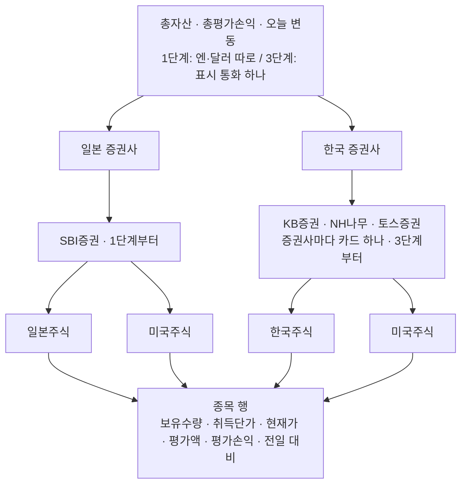
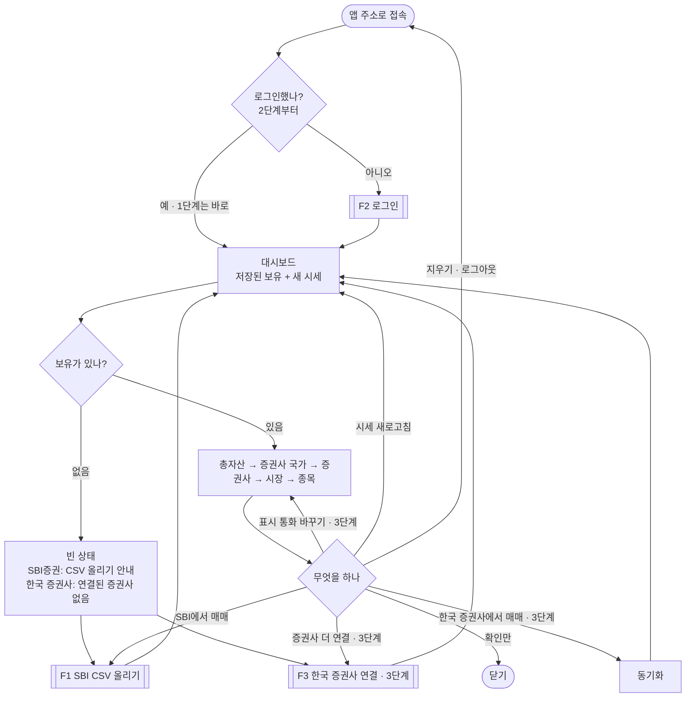
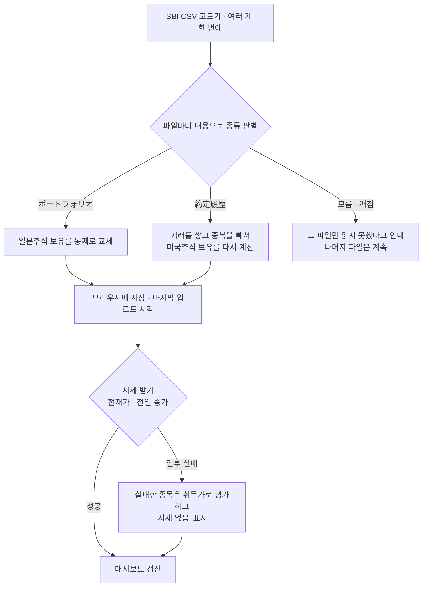
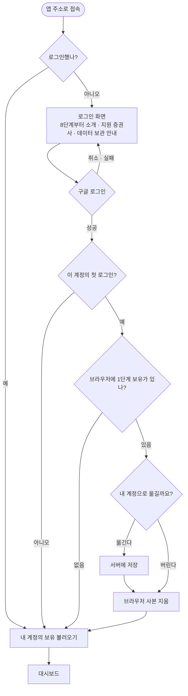
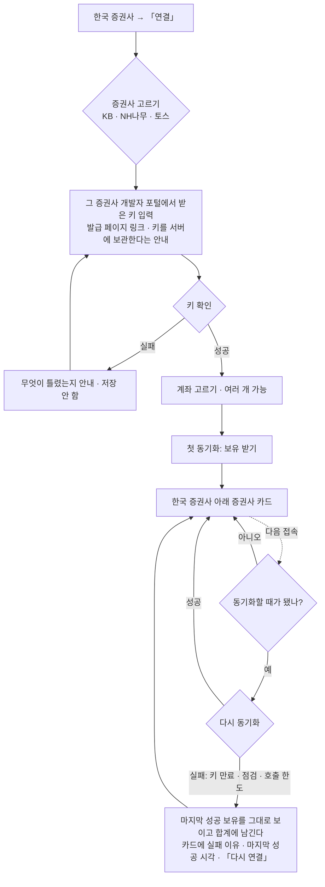

# PRD: trizon

## 목표
- 최종: 차트·기술적 분석, 펀더멘탈, 거시 상황과 경기 사이클을 바탕으로 종목별 매수·매도 판단과 중기·장기 시나리오를 제공한다. AI 채팅으로 이 정보들을 모아 판단한다.
- 1~3단계: 일본·한국 증권사에 흩어진 주식 자산을 한 대시보드에서 본다.
- 지금(1단계): SBI증권에서 내려받은 CSV를 올리면 일본·미국 주식의 현재 손익과 전일 대비를 한 화면에서 볼 수 있게 한다.

## 사용자
일본·한국 증권사에 주식 계좌를 가진 개인 투자자. 일본·미국·한국 주식을 엔·달러·원으로 갖고 있고, 주로 PC에서 본다.

- 1~7단계: 만든 사람 한 명이 쓴다. 앱은 로컬에서 돌리고, 개발 리뷰에는 접근을 제한한 Vercel PR 미리보기를 쓴다. 2단계부터 데이터는 Supabase 클라우드에 둔다. 계좌는 SBI증권(일본)과 KB증권·NH투자증권(나무)·토스증권(한국)이다. 1단계는 SBI증권만 다룬다.
- 8단계(배포) 뒤: 다른 사람도 자기 구글 계정으로 쓴다. 대상은 일본·한국 계좌를 둘 다 가진 사람과 한국 증권사만 쓰는 사람이다. 화면은 한국어다.
- 지원 증권사는 위 4곳으로 고정한다.

이 앱으로 하려는 일:
- 전체 주식 자산이 지금 얼마이고, 산 값보다 얼마 오르거나 내렸는지 본다.
- 오늘(전일 대비) 얼마 움직였는지 본다.
- 일본 증권사와 한국 증권사에 각각 얼마 있는지 본다.
- 어느 종목이 손익을 끌고 있는지 본다.
- 매매한 뒤 바뀐 보유를 반영한다.

## 단계
1. SBI증권 CSV 업로드 + 일본·미국 주식 현재 손익 ← 지금
2. 구글 로그인 + 유저별 데이터 저장 (Supabase)
3. KB·NH·토스 API 연동 (한국주식·미국주식) + 통합 자산 화면 + 환율(표시 통화로 총자산 합산, 미국주식은 계좌통화 기준 손익)
4. 거시·경제 지표 (S&P 500, 나스닥, VIX, 환율 등)
5. 지수·종목별 차트 (모두 종가 기준)
6. 기업 펀더멘탈
7. AI 채팅으로 4~6의 정보를 모아 매수·매도 판단과 시나리오 추천
8. 배포 + 다른 사용자에게 공개

자산 화면에 더할 것 (단계 미정)
- 자산 배분: 평가액 기준으로 종목·시장 비중을 본다. 3단계의 환율로 원·엔·달러를 섞어 비중을 낸다.
- 배당: 배당금, 배당 이력, 배당금 추이.

## 사용자 흐름 (1~3단계)
1~3단계를 한 흐름으로 본다. 단계가 올라가면 같은 대시보드의 빈 곳이 채워진다. 8단계에 다른 사용자가 들어올 때의 흐름은 J4와 U37~U40에 있다. 정하지 못한 것은 「열린 질문」에 있다.

용어
- 증권사 국가: 증권사가 있는 나라. 일본 증권사 = SBI증권, 한국 증권사 = KB증권·NH투자증권(나무)·토스증권.
- 총자산: 주식 평가액의 합. 현금(예수금)은 넣지 않고, 화면에 "현금 제외"라고 적는다.
- 전일 대비: (현재가 − 전일 종가) × 보유수량.
- 계좌통화(3단계): 증권사 계좌의 기본 통화. SBI는 엔, 한국 3사는 원. 미국주식 손익도 이 통화로 내서 증권사 앱과 맞춘다. 환차손익이 들어간다.
- 표시 통화(3단계): 총자산을 모아 보이는 통화. 원·엔·달러 중 고른다. 기본은 원화이고, 마지막에 고른 통화를 기억한다.

### 가설
아래 가설을 전제로 흐름을 짰다. 틀린 것으로 드러나면 「틀리면」 열처럼 바꾼다.

| # | 가설 | 틀리면 | 확인 방법 |
|---|---|---|---|
| H1 | 보유는 매매할 때만 가끔 바뀌고, 시세는 매일 바뀐다. 그래서 방문 대부분은 "열고 보기"다. | CSV 올리기가 가장 큰 마찰이 된다. 올리기를 쉽게 만드는 일을 앞당긴다. | 1단계를 2주 쓰며 연 횟수와 올린 횟수를 센다. |
| H2 | "전체 얼마" → "어느 나라 증권사에 얼마" → "어느 종목" 순서로 내려가며 본다. | 시장(일본·미국·한국주식)별로 먼저 보려 한다면 「자산 배분」을 앞당긴다. | 실제로 어느 영역부터 펼치는지 본다. |
| H3 | 증권사 앱의 숫자와 대조한다. 숫자가 다르면 앱을 믿지 않는다. 그래서 3단계부터 미국주식도 계좌통화 기준으로 낸다. | 대조하지 않는다면 달러 기준으로 단순화한다. | 실제 CSV로 SBI 화면과 맞춰 본다(열린 질문 「실제 CSV로 확인」). |
| H4 | 한국 3사의 개인용 공식 API로 보유를 받을 수 있다. | 그 증권사는 연결하지 못한다. 카드에 "지원 안 됨"을 보이고 CSV나 직접 입력을 검토한다. | 3단계 착수 전에 증권사마다 spike를 한 번 한다. 2026-09 조사는 [ARCHITECTURE.md](ARCHITECTURE.md) 「v1 참고」에 있다. |
| H5 | 숫자 하나로 된 총자산이 있어야 "한눈에" 보인다. | 통화별 합계로 충분하면 환율을 4단계로 되돌린다. | 3단계에서 표시 통화 전환을 실제로 쓰는지 본다. |
| H6 | 증권사 국가 틀을 처음부터 보여 두면, 3단계에서도 다른 사용자가 와도 화면을 다시 익히지 않아도 된다. | 빈 칸이 거슬리면 보유가 없는 증권사 국가는 숨긴다. | 1단계를 쓰며 판단한다. |
| H7 | 다른 사용자(8단계)는 자기 증권사 API 키를 이 앱에 맡긴다. | 한국 증권사만 쓰는 사람은 쓸 것이 없어진다. 키를 맡기지 않아도 되는 방식을 찾는다. | 배포 전에 대상자 몇 명에게 물어본다. |
| H8 | 증권사 개인용 API 약관과 한국 마이데이터 규제가, 서버가 다른 사람의 키로 대신 조회하는 것을 허용한다. | 다른 사용자에게 한국 증권사 연결을 열지 않는다(열린 질문 「다른 사용자의 한국 증권사 연결」). | 3단계 착수 때 각 증권사 약관을, 배포 전에 규제를 확인한다. v1 결정 002에 "마이데이터는 인가받은 사업자만"이라는 기록이 있다. |

### 대시보드 구조
대시보드가 첫 화면이고 모든 흐름의 출발점이다. 위에서 아래로 갈수록 범위가 좁은 숫자를 보인다.

| 영역 | 1단계 | 2단계 | 3단계 |
|---|---|---|---|
| 첫 화면 | 대시보드 | 로그인하지 않았으면 로그인 화면 → 대시보드 | 같음 |
| 맨 위 합계 | 엔·달러 따로, 평가손익·전일 대비 | 같음 | 표시 통화 하나로 총자산·총평가손익·오늘 변동, 원·엔·달러 전환 |
| 일본 증권사 › SBI증권 | CSV 올리기, 시장별 표 | 같음 | 같음 + 표시 통화로 환산한 소계 |
| 한국 증권사 | "연결된 증권사 없음" | 같음 | 증권사 카드, 「연결」·「동기화」 |
| 보유가 없는 증권사 국가 | 한 줄로 접어 아래에 둔다 | 같음 | 같음 |
| 미국주식 손익 | 달러 기준 | 같음 | 계좌통화(SBI 엔, 한국 원) 기준, 환차손익 포함 |
| 보유 저장 위치 | 브라우저 | 내 계정(Supabase) | 같음 + 증권사 키(Supabase Vault) |
| 지우기 | 「데이터 지우기」 | 로그아웃, 계정 삭제 | + 증권사 연결 해제 |

### 전체 흐름

### F1. SBI CSV 올리기 (1단계부터)

### F2. 로그인과 1단계 데이터 옮기기 (2단계)

### F3. 한국 증권사 연결과 동기화 (3단계)

### 여정
주요 경로를 따라간다. 「막히는 곳」의 U번호는 아래 「상황별 동작」을 가리킨다.

J1. 처음 시작 (나, 1단계 → 3단계)

| 순서 | 사용자 | 앱 | 막히는 곳 |
|---|---|---|---|
| 1 | 접속한다 | 빈 대시보드(U1) | 어느 CSV를 받을지 모른다 → U1의 안내 |
| 2 | SBI 사이트에서 CSV 2개를 받는다 | (앱 밖) | `約定履歴`은 최근 2년만 받을 수 있다 → U11 |
| 3 | 두 파일을 함께 올린다 | 보유를 보이고 저장한다(U2) | 잘못된 파일 → U4 |
| 4 | SBI 화면과 대조한다 | — | 숫자가 다르다 → U14 |
| 5 (3단계) | 한국 증권사 포털에서 키를 받아 연결한다 | F3 | 앱 밖에서 하는 발급이 가장 번거롭다 → 발급 페이지 링크 |

J2. 매일 확인

| 순서 | 사용자 | 앱 | 막히는 곳 |
|---|---|---|---|
| 1 | 접속한다 | 저장된 보유를 바로 그린다(U6 · U19 · U26) | 시세가 늦다 → 보유를 먼저 보이고, 시세 칸만 "받는 중" |
| 2 | 맨 위 총자산·총평가손익·오늘 변동을 본다 | 1단계는 엔·달러 따로, 3단계는 표시 통화 하나 | 환율을 못 받음 → U32 |
| 3 | 일본·한국 증권사를 비교한다 | 증권사 국가·증권사별 소계 | 동기화 실패 → U27 |
| 4 | 손익이 크거나 오늘 많이 움직인 종목을 본다 | 종목 표 | 시세 없는 종목 → U8, 시장마다 다른 "오늘" → U10 |

J3. 매매한 뒤 반영

| 경우 | 사용자 | 앱 | 막히는 곳 |
|---|---|---|---|
| SBI | 매매 → CSV 다시 받기 → 올리기 | `ポートフォリオ`는 교체, `約定履歴`은 거래 누적(U5 · U41) | 한 파일만 올리면 그 종류만 바뀐다(U3), 오늘 매매한 종목의 전일 대비 → U9 |
| 한국 증권사 (3단계) | 매매 → 「동기화」 또는 다음 접속 | U26 | 실패 → U27 |
| 오래 안 올림 | — | 마지막 업로드 시각(U6) | 보유가 낡은 줄 모른다 → "N일 전"으로 알린다 |

J4. 다른 사용자의 처음 시작 (8단계 배포 뒤)

| 순서 | 사용자 | 앱 | 막히는 곳 |
|---|---|---|---|
| 1 | 접속한다 | 로그인 화면에 소개·지원 증권사 4곳·데이터 보관 방식(U37) | 내 증권사가 없다 → U39 |
| 2 | 구글로 가입한다 | 빈 대시보드 | — |
| 3 | 한국 증권사를 연결하거나 SBI CSV를 올린다 | F3 · F1 | 키를 맡기기 불안하다 → H7, 연결을 열 수 없다 → H8 |
| 4 | 보유를 확인한다 | 보유가 없는 증권사 국가는 한 줄로 접힌다(U38) | — |

### 상황별 동작

| # | 단계 | 상황 | 앱이 하는 일 |
|---|---|---|---|
| U1 | 1 | 처음 접속(보유 없음) | 빈 대시보드. SBI증권 칸에 올릴 CSV 2개의 이름과 받는 곳을 적는다. 한국 증권사 칸은 "연결된 증권사 없음" 한 줄로 아래에 둔다. |
| U2 | 1 | CSV 2개를 한 번에 올림 | 내용으로 종류를 가려 일본·미국 보유를 시장별 표로 보이고 브라우저에 저장한다. |
| U2a | 1 | SBI 카드에 CSV를 끌어다 놓음 | 업로드 안내가 접혀 있어도 카드 전체에서 여러 파일을 받는다. 파일 드래그 중 테두리와 안내 문구를 강조하고, 카드 밖으로 나가거나 파일을 놓으면 해제한다. 파일 선택과 같은 검증·저장·파일별 결과를 사용하며, 텍스트 드래그와 읽는 중 추가 드롭은 처리하지 않는다. |
| U3 | 1 | `ポートフォリオ`만 올림 | 일본주식만 보인다. 미국주식 칸에 "`約定履歴` CSV를 올리면 보인다". |
| U4 | 1 | SBI CSV가 아니거나 깨진 파일 | 그 파일 이름과 "읽지 못함"을 보인다. 함께 올린 나머지 파일은 반영한다. |
| U5 | 1 | 매매 후 같은 종류를 다시 올림 | `ポートフォリオ`는 일본주식 보유를 통째로 바꾼다. `約定履歴`은 거래를 쌓고 중복을 뺀다. 둘 다 그 종류의 마지막 업로드 시각을 고친다. |
| U6 | 1 | 다시 접속(매일 확인) | 업로드 없이 저장된 보유를 보이고, 시세는 받는 대로 채운다. 평가손익과 전일 대비, 시세 시각, 마지막 업로드 시각("3일 전")을 보인다. |
| U7 | 1 | 열어 둔 채 시세를 다시 보고 싶음 | 「시세 새로고침」 버튼. |
| U8 | 1 | 시세를 못 받은 종목 | 일본주식은 먼저 열린 질문 「시세를 못 받았을 때」대로 CSV 現在値를 쓴다. 그것도 없으면 취득가로 평가하고(평가손익·전일 대비 0) "시세 없음"을 표시한다. 합계에서 빼지 않는다. |
| U9 | 1 | 오늘 사거나 판 종목 | 열린 질문 「오늘 매매한 종목의 전일 대비」. |
| U10 | 1 | 시장마다 "오늘"이 다름(일본 장 마감 뒤, 미국 장 시작 전 등) | 종목마다 시세가 주는 전일 종가를 기준으로 한다. 시세 시각을 시장별로 보인다. |
| U11 | 1 | `約定履歴`의 2년보다 전에 산 미국주식 | 계산 불가 종목은 경고와 「보유정보 입력」을 보인다. 경고가 없거나 CSV에 없는 종목도 미국주식 공통 「보유정보 입력·관리」에서 기준 보유정보로 보정한다(핵심 기능 5). |
| U12 | 1 | 같은 종목이 特定·NISA로 나뉨 | 열린 질문 「같은 종목이 特定·NISA로 나뉜 경우」. |
| U13 | 1 | 信用·投資信託 표가 있는 `ポートフォリオ` | 열린 질문 「`ポートフォリオ`의 信用·投資信託 표」. |
| U14 | 1 | SBI 화면과 숫자가 다름 | 시세 시각을 보인다. 미국 취득단가는 핵심 기능 2대로 계산한다(엔으로 결제한 매수는 수수료가 빠진다). |
| U15 | 1 | 데이터를 지우고 싶음 | 「데이터 지우기」 → 확인 → U1 화면. 확인 창에 "2년보다 오래된 거래는 SBI에서 다시 받을 수 없다"를 적는다. |
| U16 | 1 | 저장된 데이터를 읽지 못함(형식이 바뀐 뒤) | 그 데이터로 그리지 않는다. U1 화면에 "다시 올려 주세요". |
| U17 | 2 | 로그인하지 않고 접속 | 로그인 화면 → 구글 로그인 → 대시보드. |
| U18 | 2 | 첫 로그인, 브라우저에 1단계 보유가 있음 | 열린 질문 「1단계 데이터 옮기기」, F2. |
| U19 | 2 | 다시 접속(로그인 유지) | 내 계정의 보유 + 새 시세. 나머지는 U6과 같다. |
| U20 | 2 | 쓰는 중에 로그인이 만료됨 | 로그인 화면 → 로그인하면 대시보드로 돌아온다. |
| U21 | 2 | 로그아웃 | 화면의 자산을 지우고 로그인 화면으로 간다. |
| U22 | 2 | 다른 구글 계정으로 로그인 | 그 계정의 데이터만 보인다. 2~7단계는 나 혼자 쓰지만, 8단계를 위해 데이터는 처음부터 계정별로 나눈다. |
| U23 | 2 | 계정 삭제 | 보유와 (3단계부터) 증권사 키를 모두 지운다. |
| U24 | 3 | 한국 증권사 연결 | F3. 계좌가 여럿이면 고른 계좌 모두를 가져와 카드 안에서 계좌별 행으로 둔다. |
| U25 | 3 | 키가 틀림 | 무엇이 틀렸는지 보이고 저장하지 않는다. |
| U26 | 3 | 다시 접속 | 열린 질문 「한국 증권사 동기화 시점」. 「동기화」 버튼도 둔다. |
| U27 | 3 | 동기화 실패(키 만료·점검 시간·호출 한도) | 마지막 성공 보유를 그대로 보이고 합계에 남긴다. 카드에 실패 이유·마지막 성공 시각·「다시 연결」. |
| U28 | 3 | API가 일부 정보를 주지 않음 | 열린 질문 「API가 주지 않는 정보」. |
| U29 | 3 | 미국주식의 계좌통화 매입금액을 모름(토스는 종목별 원화 매입금액을 주지 않는다) | 현재 환율로 환산하고 "환차손익 빠짐"이라고 적는다. SBI는 열린 질문 「SBI 미국주식 엔화 취득가」. |
| U30 | 3 | 일부 증권사만 연결 | 총자산은 연결한 증권사만 합친다. 맨 위에 포함된 증권사를 적는다. |
| U31 | 3 | 표시 통화 바꾸기 | 총자산·총평가손익 금액만 바뀌고 총수익률(%)은 그대로다. 고른 통화를 기억한다. |
| U32 | 3 | 환율을 못 받음 | 표시 통화 총합 대신 계좌통화별 합계를 보인다. 미국주식은 달러 기준으로 돌아가고, 그렇게 적는다. |
| U33 | 3 | 미국주식 손익이 증권사 앱과 조금 다름 | 계좌통화 기준이라 기준은 같다. 환율 출처가 달라 생기는 차이라는 것을 툴팁으로 알린다. 열린 질문 「달러 기준 주가 손익 병기」. |
| U34 | 3 | 같은 종목이 여러 증권사에 있음 | 열린 질문 「같은 종목이 여러 증권사에 있을 때」. |
| U35 | 3 | 증권사 연결 해제 | 그 증권사의 키와 보유를 지우고 카드를 없앤다. |
| U36 | 3 | 한국 증권사의 예수금(현금) | 총자산에 넣지 않는다. 맨 위에 "현금 제외". |
| U37 | 8 | 처음 온 사람 | 로그인 화면에 소개·지원 증권사 4곳·데이터 보관 방식을 보인다 → 구글 가입 → 빈 대시보드. |
| U38 | 8 | 한국 증권사만 쓰는 사람 | 일본 증권사 칸은 한 줄로 접혀 아래에 있다. 열린 질문 「빈 증권사 국가 칸」. |
| U39 | 8 | 지원하지 않는 증권사를 쓰는 사람 | 지원 증권사 4곳을 알린다. 그 밖의 증권사는 받지 않는다. |
| U40 | 8 | 다른 사람이 한국 증권사를 연결하려 함 | 열린 질문 「다른 사용자의 한국 증권사 연결」. |
| U41 | 1 | `約定履歴` 파일을 여러 개 올림(1,000건이 넘어 기간을 나눔, 또는 나중에 새 기간을 올림) | 같은 파일과 겹친 거래는 한 번만 센다. 한 번 올린 거래는 2년이 지나도 남는다. |
| U42 | 1 | 잘못된 `約定履歴`을 올렸음 | 열린 질문 「잘못 쌓인 거래」. |
| U43 | 2 | Supabase 무료 프로젝트가 일시 정지됨 | 열린 질문 「Supabase 일시 정지」. |
| U44 | 1 | 시세 서버 전체 실패(오프라인, Yahoo 오류) | 모든 종목을 취득가로 보이고, 맨 위에 "시세를 받지 못했습니다"와 「시세 새로고침」을 둔다. |
| U45 | 1 | 일본주식을 다 팔고 `ポートフォリオ`를 올림 | 실패가 아니다. 일본주식 칸에 "보유 없음". |
| U46 | 1 | 브라우저에 저장하지 못함(사생활 보호 모드, 용량 초과) | 화면은 그대로 보이고 "저장되지 않았습니다. 새로고침하면 다시 올려야 합니다"를 띄운다. |
| U47 | 1 | 미국주식 분할·병합, 티커 변경 | 열린 질문 「주식 분할·티커 변경」. |
| U48 | 1 | `約定履歴`에 現買·現売 말고 다른 거래(信用 등)가 섞임 | 그 거래는 건너뛰고 "건너뛴 거래 N건"을 알린다. |
| U49 | 1 | SBI 현재 보유정보를 직접 입력 | 최신 CSV를 먼저 올리고 종목·계좌구분별 保有数量·取得単価(USD)를 입력한다. 기존 CSV 거래는 이미 반영된 것으로 기억하고 이후 새로 추가된 거래만 계산한다. 날짜 입력은 받지 않는다. 「CSV 업로드 순서 안내」로 절차를 설명한다. |
| U50 | 1 | 기준 보유정보를 수정·삭제 | 같은 종목·계좌구분의 기준값을 수정하거나, 확인 후 삭제한다. 기존 CSV 원장은 보존하고 다시 계산한다. 삭제 후 과거 매수 부족 경고가 다시 나타날 수 있음을 알린다. |
| U51 | 1 | 기준 보유정보를 0주로 입력 | 취득원가도 0으로 두고 보유표·합계에서 숨긴다. 입력·관리 화면에서는 계속 수정·삭제할 수 있고, 이후 새 거래의 매수부터 다시 계산한다. |

## 핵심 기능 (1단계)
1. 대시보드(첫 화면): `/`에서 바로 열린다. 「일본 증권사 › SBI증권 › 일본주식·미국주식」 순서로 종목별 평가액·평가손익·전일 대비와 시장별 합계(엔·달러 따로)를 보인다. 「한국 증권사」 칸은 3단계 전까지 "연결된 증권사 없음" 한 줄이다.
2. SBI증권 CSV 업로드: 보유목록(`ポートフォリオ`) CSV에서 일본주식을, 미국주식 `約定履歴` CSV에서 미국주식의 보유수량·취득단가를 읽는다. 여러 파일을 한 번에 받는다. 같은 종류를 다시 올리면 `ポートフォリオ`는 통째로 바꾸고, `約定履歴`은 거래를 쌓고 중복을 뺀다(파일당 1,000건 한계 때문에 기간을 나눈 파일을 함께 또는 따로 올릴 수 있다). 미국주식 취득단가는 이동평균이다. 매수마다 `受渡金額`(수수료 포함)이 달러면 그 값을, 엔이거나 없으면 수량 × `約定単価`(수수료 제외)를 취득원가에 더한다. 그래서 엔으로 결제한 매수가 있으면 SBI 화면의 取得単価보다 조금 낮게 나올 수 있다. 업로드 칸에 받을 파일 2개의 이름과 받는 곳을 적는다.
3. 종목별 현재 손익: 외부 시세의 현재가·전일 종가로 평가액(현재가 × 보유수량), 평가손익((현재가 − 취득단가) × 보유수량), 전일 대비((현재가 − 전일 종가) × 보유수량)를 계산한다. 시세를 못 받은 종목은 취득가로 평가하고 "시세 없음"을 표시한다. 합계에서 빼지 않는다.
4. 브라우저 저장: 보유 내역을 브라우저에 저장한다. 다시 열면 업로드 없이 새 시세로 계산한다. 시세 시각과 마지막 업로드 시각을 보이고, 「시세 새로고침」과 「데이터 지우기」를 둔다.
5. 미국주식 기준 보유정보: 현재까지 거래가 포함된 최신 CSV를 먼저 올린 뒤 SBI 현재 화면의 보유수량·달러 취득단가를 종목·계좌구분별로 직접 입력한다. 경고에서 입력하거나 공통 입력·관리 화면에서 기존 종목을 선택하고 CSV 밖 종목을 등록할 수 있다. 날짜는 입력하지 않는다. 이미 올린 해당 종목·계좌의 거래를 반영된 거래로 기억하고, 같은 날 거래를 포함해 이후 추가된 거래만 더한다. 「CSV 업로드 순서 안내」는 기간별 파일을 먼저 모두 올릴 것, 입력 중 매매가 생기면 CSV부터 다시 확인할 것, 과거 기간 CSV를 나중에 추가했다면 현재 보유정보를 다시 입력할 것을 알린다. 기준값은 종목·계좌구분별 하나로 관리하고 직접 입력한 출처를 보인다. 수정·삭제·0주를 지원하며 CSV 원장은 그대로 보존한다. 입력값의 정밀도와 이후 엔 결제 매수의 수수료 미반영에 따른 차이는 남는다.

## 1단계 완료 기준
테스트가 생기면 테스트를 원본으로 삼고 이 절은 지운다.

가짜 보유 내역 기준이다. 일본주식은 엔, 미국주식은 달러. 미국주식은 `約定履歴`의 매수 1건씩(달러 결제, 수수료 0)으로 만들고, 현재가·전일 종가는 테스트용 가짜 시세가 준다.

| 종목 | 시장 | 보유수량 | 취득단가 | 현재가 | 전일 종가 | 평가액 | 평가손익 | 전일 대비 |
|---|---|---|---|---|---|---|---|---|
| JP-A | 일본 | 10 | 1,000 | 1,200 | 1,150 | 12,000 | +2,000 | +500 |
| JP-B | 일본 | 10 | 900 | 800 | 820 | 8,000 | -1,000 | -200 |
| US-A | 미국 | 4 | 50.00 | 45.50 | 46.00 | 182.00 | -18.00 | -2.00 |
| US-B | 미국 | 2 | 20.00 | 25.00 | 24.50 | 50.00 | +10.00 | +1.00 |

1. 앱 주소로 처음 접속하면 대시보드가 열린다. 보유가 없으면 SBI증권 칸에 CSV 올리기 안내가 보이고, 한국 증권사 칸에 "연결된 증권사 없음"이 보인다.
2. 가짜 CSV 2개(`ポートフォリオ`, `約定履歴`)를 올리면 4종목이 보인다. 보유수량·취득단가는 위 표와 같고, JP-A·JP-B는 일본주식, US-A·US-B는 미국주식으로 나뉜다. 4종목은 모두 「일본 증권사 › SBI증권」 아래에 있다.
3. 4종목의 평가액·평가손익·전일 대비가 표와 같다. 이익·상승은 +, 손실·하락은 -로 보인다. 미국주식의 소수 가격을 버리지 않는다(US-A 평가액은 180이 아니라 182.00).
4. 일본주식 합계는 평가액 20,000 · 평가손익 +1,000 · 전일 대비 +300이다. 미국주식 합계는 평가액 232.00 · 평가손익 -8.00 · 전일 대비 -1.00이다.
5. 새로고침해도 4종목과 합계가 그대로 보인다. 「데이터 지우기」를 누르면 1번의 빈 대시보드로 돌아간다.

## 제약 조건
- 실행 환경: 1단계는 로컬과 Vercel PR 미리보기에서 실행한다. 미리보기는 Vercel 계정으로 접근을 제한한다([배포·리뷰 절차](DEPLOYMENT.md)). 앱 로그인·DB는 없다. 보유 내역은 브라우저(localStorage)에만 두고 서버는 저장하지 않는다. 주소가 다르면 저장소도 분리된다.
- 대상: SBI증권 계좌의 일본주식(엔)과 미국주식(달러)만.
- 데이터 출처: 보유 내역은 사용자가 SBI증권에서 받은 CSV를 직접 올린다. 미국주식은 보유 CSV가 없어서 `約定履歴`으로 추정한다. 현재가는 외부 시세 API에서 받는다.
- 테스트용 CSV: 실제 SBI CSV는 로컬에만 두고 형식 참고와 화면 확인에만 쓴다. 커밋하지 않고, 그 안의 종목·수량·금액을 코드·테스트·문서에 옮기지 않는다. 자동 테스트는 가짜 값으로 만든다.
- 공개 리포: 실제 금액·계좌번호를 넣지 않는다.
- 기술 스택: Next.js + TypeScript. 2단계부터 로그인·DB는 Supabase(구글 로그인). 개발 리뷰용 배포는 Vercel이고, 다른 사용자 대상 공개 배포는 8단계에 정한다. 구조는 [ARCHITECTURE.md](ARCHITECTURE.md)에 있다.

## MVP 제외 사항
- 이번 단계 범위 밖: 로그인, SBI 외 증권사 연동, 한국주식, 환율·한 통화 총자산·미국주식 계좌통화 기준 손익(3단계), 자산 배분(비중), 배당 정보, 트레이딩 화면(지표·차트·펀더멘탈), AI 채팅과 시나리오 제공, 다른 사용자 대상 공개 배포(8단계).
- 대상 아님: 일본·미국·한국 외 시장의 주식, SBI·KB·NH·토스 밖의 증권사, 일본 증권사만 쓰는 사람(일본어 화면), 현금(예수금).

## 디자인
UI는 shadcn/ui + Tailwind로 만든다([ARCHITECTURE.md](ARCHITECTURE.md) 「스택」). 디자인 시스템은 [DESIGN.md](../DESIGN.md)에 있다.

## 열린 질문
기본값으로 진행한다. 정해지면 해당 절로 옮기고 여기서 지운다.

1. 2년보다 오래된 미국주식: 핵심 기능 5의 기준 보유정보로 보정한다. 기준값이 없는 종목에서 매도가 매수보다 많으면 보유에서 빼고 "계산할 수 없음: 2년 이전 매수분 필요"와 입력 버튼을 보인다.
2. `ポートフォリオ`의 信用·投資信託 표: 기본: 읽지 않고 "건너뛴 표 N개"라고 안내한다.
3. 같은 종목이 特定·NISA로 나뉜 경우: 기본: 계좌구분별로 행을 따로 둔다.
4. 시세를 못 받았을 때: 기본: 일본주식은 취득가보다 먼저 CSV의 現在値로 평가하고 그렇게 표시한다. 그 밖의 경우는 핵심 기능 3대로 취득가로 평가한다.
5. 실제 CSV로 확인: 기본: 구현이 끝나면 사용자가 `download/`(gitignore됨)에 두고 직접 올려 확인한다. Claude는 머리글만 읽고 값은 옮겨 적지 않는다.
6. 한국 증권사 동기화 시점(3단계): 기본: 대시보드를 열 때 마지막 동기화가 15분을 넘었으면 다시 받는다. 「동기화」 버튼도 둔다.
7. API가 주지 않는 정보(3단계): 기본: 받은 것만 보이고, 빠진 것(예: KB 해외주식 보유)은 증권사 카드에 적는다. 직접 입력 화면은 만들지 않는다.
8. 같은 종목이 여러 증권사에 있을 때: 기본: 증권사별로 따로 보인다. 합쳐 보기는 「자산 배분」(단계 미정)에서 다룬다.
9. 1단계 데이터 옮기기(2단계): 기본: 첫 로그인 때 한 번 묻는다. 옮기든 버리든 브라우저 사본은 지운다.
10. 빈 증권사 국가 칸: 기본: 보유가 없는 증권사 국가는 한 줄("연결된 증권사 없음" 또는 "CSV 올리기")로 접어 아래에 둔다.
11. 오늘 매매한 종목의 전일 대비: 기본: 지금 보유수량 × (현재가 − 전일 종가)로 낸다. 오늘 산 값이나 판 수량은 반영하지 않는다.
12. SBI 미국주식 엔화 취득가(3단계): 기본: 쌓아 둔 거래의 엔화 受渡金額으로 낸다. 그 금액이 없으면 현재 환율로 환산하고 "환차손익 빠짐"이라고 적는다. 3단계 착수 때 CSV 머리글로 확인한다.
13. 달러 기준 주가 손익 병기(3단계): 기본: 미국주식은 계좌통화 기준 손익 옆에 달러 기준 손익을 작게 보인다. 주가 효과와 환율 효과를 나눠 보기 위해서다.
14. 미국주식 전일 대비의 환율(3단계): 기본: 주가 변동을 현재 환율로 환산한다. 환율의 하루 변동은 넣지 않는다.
15. 다른 사용자의 한국 증권사 연결(8단계): 기본: 가설 H8을 확인하기 전에는 다른 사용자에게 열지 않는다. 그동안 다른 사용자는 SBI CSV만 쓸 수 있다.
16. 배포처(8단계): 기본: 8단계 착수 때 앱 배포처만 정한다. DB·로그인은 Supabase를 그대로 쓴다.
17. 잘못 쌓인 거래: 기본: 「데이터 지우기」로 전부 지우고 다시 올린다. 파일 단위 되돌리기는 만들지 않는다.
18. Supabase 일시 정지(2단계): 기본: 열 때 연결이 안 되면 일시 정지 안내와 재개 방법(Supabase 대시보드에서 재개)을 보인다. 깨워 두는 자동 호출은 두지 않는다.
19. 주식 분할·티커 변경: `約定履歴`에는 분할이 나오지 않아서, 분할 전 거래의 수량·단가가 그대로 남는다. 기본: 1단계는 미국주식 칸에 "約定履歴으로 추정한 값"이라고 적고 자동 보정하지 않는다. 사용자는 핵심 기능 5로 현재 보유를 직접 보정할 수 있다. 「실제 CSV로 확인」에서 틀린 종목이 나오면 Yahoo 분할 이력으로 자동 보정을 붙인다.
